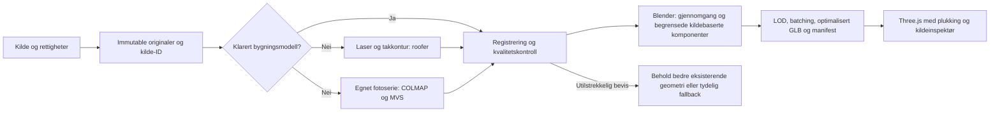

# Arkitektonisk rekonstruksjon: anbefalt metode før oppskalering

Undersøkt **19. oktober 2026**. Utgangspunkt: R1C,
`358b3e03649de9550af66697a76d86471e53ccee`, kun `feature/bergen-simulator`.
Dette er en metodeundersøkelse med isolerte prototyper, ikke en ny bygningsleveranse,
geografisk revisjon, offentlig LIVE-lansering eller godkjenning av masseproduksjon.

## Anbefaling

Bruk en **kildestyrt hybridpipeline**, med gjenbruk av en oppmålt modell som første
valg når en slik leveranse faktisk kan klareres. Ellers: behold dokumenterte
fotavtrykk/identiteter, bruk klassifisert laser og takkonturer til tak og volum,
COLMAP + en MVS-motor til fasader fra egnede flerbildeserier, og Blender til kontroll,
retopologi og begrenset komponentrekonstruksjon. Lever til eksisterende Three.js/R3F
som kildeidentifiserte, optimaliserte GLB-fliser med LOD og fallback.

**Ikke gjør OSM2World til hovedmetode for landemerker.** Skur-prototypen viser konkret
hvorfor: verktøyet beholder byggets identitet og grunnform, men lager standardvinduer
uten bildestøtte og velger 3,5 m høyde når metrisk høyde mangler. Det er ikke en
forbedring av den eksisterende, kildeavledede modellen.

Den største uløste avhengigheten er **rettighetsklarerte, sammenhengende fasadebilder
eller terrestriske skanninger**, ikke mangel på enda et modelleringsbibliotek.
De fem eksisterende historiske Skur-fotografiene gir gode visuelle holdepunkter,
men ga ingen initialisert SfM-modell i to faktisk kjørte COLMAP-oppsett.
Dette er et avgrenset negativt resultat, ikke bevis for at fotogrammetri generelt
mislykkes eller at andre bildesamlinger ikke finnes.

## Rangert oversikt

Rangeringen gjelder egnethet for vårt mål og arbeidsflyt, ikke en universell
poengsum. Verktøy i samme pipeline er komplementære.

| Prioritet | Løsning | Anbefalt rolle | Avgjørende begrensning |
|---|---|---|---|
| 1 | Rettighetsklarert eksisterende oppmåling + hybridintegrasjon | Unngå ny rekonstruksjon når originalmodell/punktsky med dokumentasjon kan gjenbrukes | Ingen komplett, fritt gjenbrukbar Skur/Bryggen-leveranse ble bekreftet i det avgrensede søket |
| 2 | **COLMAP + OpenMVS**, Blender | Første tekniske pilot for kildebasert fasadedybde, åpninger og tekstur | Krever overlappende, konsistente fotografier og målestokk/kontrollpunkter. Våre fem bilder bestod ikke initialisering. MVS-delen er ikke kjørt |
| 3 | **PDAL + roofer** | Automatiser rensing, kvalitetskontroll og LoD2.2-tak fra klassifisert laser + takavgrensning | Gir ikke automatisk vinduer/dører/fasader. Krever egentlige punktskyer, ikke rasterceller omdøpt til LiDAR |
| 4 | **Blender + BlenderGIS** | GIS-registrering, kildeoverlegg, komponenter, kontroll og eksport | GIS-import er ikke fotogrammetri og skaper ikke arkitektoniske fakta. BlenderGIS er vurdert, ikke kjørt som rekonstruksjonsmotor |
| 5 | **OSM2World** | Schematiske bakgrunnsbygg utenfor detaljområdet, dersom det gir bedre dokumentert fallback | Manglende metadata erstattes av standarder. Ikke bruk genererte vinduer/høyder som observerte egenskaper; ikke erstatt bedre eksisterende geometri |
| 6 | **Meshroom / AliceVision** | Alternativ GUI/arbeidsflyt for fotogrammetri når bildegrunnlag og maskinvare passer | Dokumentert MVS-løype krever NVIDIA/CUDA; CPU «draft meshing» er ikke likeverdig med tett rekonstruksjon. Ikke kjørt her |
| 7 | **OpenDroneMap** | Sammenhengende fly-/skråbildeserier, terreng/ortofoto og arealrekonstruksjon | Ikke en løsning på manglende gatefasader. Krever lovlig bildeserie og eventuell separat fly-/opptakstillatelse; ingen oppdrag bestilt |
| 8 | **3dfier / City3D / City4CFD** | Alternativer for volum/tak og annen faglig geometri | Sammenlign med roofer først ved faktisk egnet lasergrunnlag; de løser ikke fotorealistiske fasader alene |
| 9 | **VGGT**, lært matching/dybde; **gsplat/NeRF** | Avgrenset FoU, mulige kameraforslag eller visuell referanse | Lærte forslag er ikke verifisert geometri. Splats krever egen render-/plukkestrategi og er ikke direkte en redigerbar bygningsmesh. Ikke standard LIVE-lag |

Se [kilde- og lisensregisteret](reconstruction-research-2026-10-19/source-register.md)
for primærkilder, versjonsforskjeller og rettighetsvilkår. «Open source» gjelder
programvaren; bilder, teksturer, treningsvekter og ferdige modeller må klareres separat.

## Hva som faktisk finnes av Bergen-data

- **Kartverket Høydedata:** Den eksisterende åpne Bergen 10pkt 2022-leveransen er
  et relevant grunnlag for tak/terreng. R1B/R1C inneholder allerede en 0,5 m DOM-crop,
  ikke hele den klassifiserte punktskyen. Luftbåren datafangst garanterer ikke
  synlighet av fasader, portnisjer eller undersider. Ingen ny snapshot er hentet inn.
- **FKB-Bygning:** Nyttige bygnings-/takkant-/mønelinjer i produktmodellen, men ikke
  ferdige teksturerte bygningssolider. Bergens undersøkte `Bygning_Flate` er 2D
  (`hasZ=false`). Beskrivelsen bruker både «åpne data» og kjøpskrav for private.
  Dette er ikke tilstrekkelig klarering av kommersiell rekonstruksjon og hosting.
- **Kommunale 3D- og høydetjenester:** Offentlig katalog viser blant annet et lite
  Dokken-terreng og et punktlag for bygningshøyder. Det dokumenterer tjenester,
  ikke en åpent lisensiert, detaljert Bryggen-mesh. Ingen fliser eller visningsbuffer
  er hentet ut. Eldre bymodell-omtale og årsmelding beviser heller ikke tilgjengelig
  redistribusjonsrett i 2026.
- **PAST Bredsgården 1A:** Et faktisk oppmålingsprosjekt beskriver terrestrisk laser,
  fotogrammetri, punktsky, ortobilder og tegninger. Sterk kandidat til gjenbruk hvis
  leveranse og rettigheter kan avklares; ingen åpen nedlastingslisens ble funnet.
- **Ferdige Bryggen-modeller:** To konkrete Sketchfab-kandidater har API-metadata,
  men begge har `isDownloadable=false` og ingen oppgitt lisens. De er ikke brukt.
  Ingen nedlastbar Skur 11-modell ble bekreftet. Dette er ikke en uttømmende
  konklusjon om alle kommunale, private eller ikke-indekserte arkiver.
  Et utvidet søk fant også **Bergen V1**, nedlastbar under CC BY 4.0, men Minecraft-
  tagget og med omtrent 7 millioner trekanter, uten dokumenterte mål eller CRS.
  Den er ikke dokumentert egnet som arkitektonisk nøyaktig kilde.
- **Kommersielle bymodeller:** Anyscape og en undersøkt CGTrader-modell tilbyr
  bykontekst/massing. Det er ikke dokumentert fasaderekonstruksjon av Skur 11.
  Anyscape oppgir blant annet LoD1-kilde og pris fra USD 99; det er markedsført
  startpris, ikke et innhentet tilbud. Ingen kjøp, bestilling eller kontakt er utført.

## Avgrensede prototypefunn

[Resultater, bilder og råmålinger](reconstruction-research-2026-10-19/prototype-results.md)
er fra et separat lokalt testmiljø, ikke endringer i den beskyttede applikasjonen.

| Forsøk | Faktisk resultat | Hva det betyr |
|---|---|---|
| OSM2World 0.4.0, opprinnelig Skur-kontur/tags, LOD4 | 2,43 s kompilering, 1 162 trekanter, 127 448 byte, ingen tekstur. Generiske vinduer og standardhøyde | Rask automatikk, men feil detaljering for dette landemerket. Avvist som erstatning |
| PyCOLMAP 4.0.3, fem lisensierte bilder, 1600 px/SIFT | 24,05 s, ca. 1,16 GiB prosess-topp-RSS, ingen initialisert modell | Enkelte bildepar matcher, men det er ikke en rekonstruert bygning |
| Samme bilder, 2400 px/affin DSP-SIFT | 61,74 s, ca. 2,19 GiB topp-RSS, fortsatt ingen initialisert modell | Mer beregning alene fjernet ikke databegrensningen; ingen tett mesh eller kunstig utfylling |
| R1C, identisk indeksering | 402 684 → 323 456 byte; 3 716 trekanter; eksakt utvidet posisjonsrekkefølge | Reelt potensial for mindre buffer-/filbruk uten å tegne bygget på nytt |
| R1C, Meshopt + dokumentert kvantisering | 54 080 byte, fortsatt 3 716 trekanter, største symmetriske nærmeste-vertex-avvik ca. **0,35 mm mot R1C-modellen** | Lovende leveringsoptimalisering, ikke en påstand om millimeternøyaktighet mot virkeligheten. Ikke aktivert i appen |

Målingene gjelder **ett uttrekk av Skur**, uten de seks nabobyggene og fotoatlaset
i originalflisen på 675 280 byte. Filreduksjonen på ca. 86,6 % kan ikke overføres
til hele byen eller tolkes som bedre arkitektonisk nøyaktighet.

Det isolerte Three.js-forsøket verifiserer lasting, bevart kilde-ID, plukking og
null tomgangsframes på desktop og emulert berøringsflate. Det bruker en felles enkel
shader. Det er ikke materialvalidering eller måling av hele byrendererens ytelse.
Native desktop-/mobil-GPU, termikk, Safari og ekte berøring er fortsatt uverifisert.

## Foreslått automatisert pipeline

1. **Klarer først.** Rettighetshaver, original-URL, opptaksdato, kommersiell bruk,
   endring, baking, komprimering, nettlevering av hentbare GLB/teksturer,
   attribusjon/share-alike og eventuelle personvernbegrensninger må dokumenteres.
   Ingen nedlasting fra beskyttede visningsbuffere eller begrensede karttjenester.
2. **Bevar originaler.** SHA-256, original-ID og rå koordinater/CRS/vertikalt datum
   beholdes. Eventuelle nye data legges i separat revidert kildesett; gamle snapshots
   overskrives ikke. OSM-fotavtrykk er kartfestede kilder, ikke automatisk eksakte
   oppmålte vegglinjer. Takkant og veggliv må ikke forveksles.
3. **Registrer og kvalitetssjekk.** Arbeid i dobbelpresisjon/EUREF89 UTM32 og NN2000
   når kilden oppgir dette. Bruk eksplisitte transformasjoner til eksisterende lokalt
   renderkoordinatsystem og små lokale flise-origo før float32. Ikke bland
   ellipsoidehøyde med NN2000. Match flere kilder mot faktisk objekt, ikke kun nærmeste
   sentrumspunkt. Avvis tvetydige sammenfall og måle-/epokekonflikter.
4. **Rekonstruer de synlige delene.** PDAL/roofer for dokumenterte takflater;
   COLMAP/MVS for egnede fasadebilder. En SfM-reprojeksjonsfeil er ikke metrisk
   sannhetskontroll. Målestokk og geografisk forankring krever uavhengige holdepunkter.
   Maskering av biler/personer/reflekser må være reproduserbar og lagres som avledning.
5. **Kontroller arkitekturen.** Blender brukes til å gjennomgå fasadeåpninger,
   takoverheng og sammenføyninger. Parametriske nisjer/rammer/paneler gjenbrukes der
   kildeposisjoner er dokumentert. Ukjente flater får ikke gjettede vinduer. AI kan
   foreslå korrespondanser/segmentering; alle geometriforslag må etterprøves eller
   forkastes. Ingen AI-generert skjult fasade blir en geografisk observasjon.
6. **Optimaliser uten å miste identitet.** Behold en kildeankret master, lag LOD-er,
   del materialer/atlas, indeksér, og mål eventuell Meshopt-/KTX2-kvantisering mot
   master og referansebilder. Teksturkomprimering er ikke testet her. Etiketter
   skiller observasjon, kildeavledet rekonstruksjon, skjematikk og kunstnerisk finish.
7. **Lever kontrollert.** Per-bygg/per-flis manifest med kilder, lisens, epoke,
   transform, grenser, feilbudsjetter og hash. Utvid dagens strenge loader kontrakt
   eksplisitt før nye utvidelser/indekser godtas. Scenarioformatene endres ikke.
   Bygg videre på R3F, etterspørselsrendering og eksisterende geometriprosessering.
   Vurder 3D Tiles via Three.js-adapter først når flere målte fliser begrunner det;
   ikke bytt til en ny motor eller kjøp en skytjeneste nå.

## Kostnader, skalerbarhet og beslutning

Ingen lisensavgift for de foreslåtte åpne verktøyene; copyleft-/tredjepartsforpliktelser
må fortsatt følges når programvare distribueres. Dette betyr ikke at alle inngangsdata
er gratis. Brukbare FKB-/scan-/bildeleveranser, feltopptak og faglig gjennomgang kan
koste penger; ingen slike kostnader er bestilt eller påstått kartlagt som tilbud.

Første kostnadsdriver er kildeanskaffelse og aksept, deretter registrering/opprydding.
Vi har målt maskintid for ett bygg, **ikke manuelle timer per godkjent bygg**.
Planlegg med `T_total = T_oppsett + Σ(T_kilde + T_registrering + T_maskin +
T_gjennomgang + T_retting)`. Økonomisk kostnad følger faktisk timepris/maskinpris og
tilbud, ikke en oppdiktet sats. Ett enkelt eksempels raske OSM-konvertering er ikke
et estimat for en full by, og uttømmende bildematching skalerer kvadratisk.

Opplasting av 100 uoptimaliserte Skur-uttrekk ville tilsvare omtrent 40 MB geometri;
100 av den testede komprimerte varianten omtrent 5,4 MB, **uten teksturer, metadata,
ulike bygningstyper eller dekoder**. Det er kun aritmetiske illustrasjoner. Streaming,
LOD, batching og begrenset cache må forhindre at alle detaljer lastes samtidig.
Komprimerte GPU-attributter garanterer heller ikke mindre peak-RAM under dekoding.

**Neste fase:** [R1D – kildeanskaffelse og rekonstruksjonsvalidering](reconstruction-research-2026-10-19/next-phase.md).
Avklar én faktisk oppmålingsleveranse eller en egnet, lisensiert fotoserie; test
Skur og ett særpreget nabobygg før skalering. Bevis silhuett, proporsjoner,
fasadedybde, flervinkelkonsistens og materialtroverdighet med referanser og fysisk
maskinvare. Ingen masseproduksjon før denne aksepten.

## Leveranse og isolasjon

[Reproduksjon](reconstruction-research-2026-10-19/reproduction.md),
[kilder](reconstruction-research-2026-10-19/source-register.md),
[prototyper og bilder](reconstruction-research-2026-10-19/prototype-results.md).
Alle endringer er dokumentasjon og isolerte forskningsartefakter under simulatorens
dokumentmappe. Applikasjon, avhengigheter, snapshots, lagrede scenarier, workflows,
`main`, Fellestall og Vercel-konfigurasjon er urørt. Ingen ny utrulling er nødvendig
for denne undersøkelsen. Faktisk utførte kontroller registreres i
undersøkelsens `validation.json`; fraværende fysiske målinger regnes ikke som bestått.

Tilleggsundersøkelsen [Missing Buildings Reconstruction Pipeline](missing-buildings-reconstruction.md)
måler OSM/Microsoft/Overture-dekning, tester høyde-/takhypoteser på 72 eksisterende
bygg og undersøker bygningspunkter ved konkrete hullkandidater. Den foreslår en
karantenebasert utvidelse uten å erstatte bedre eksisterende geometri.
