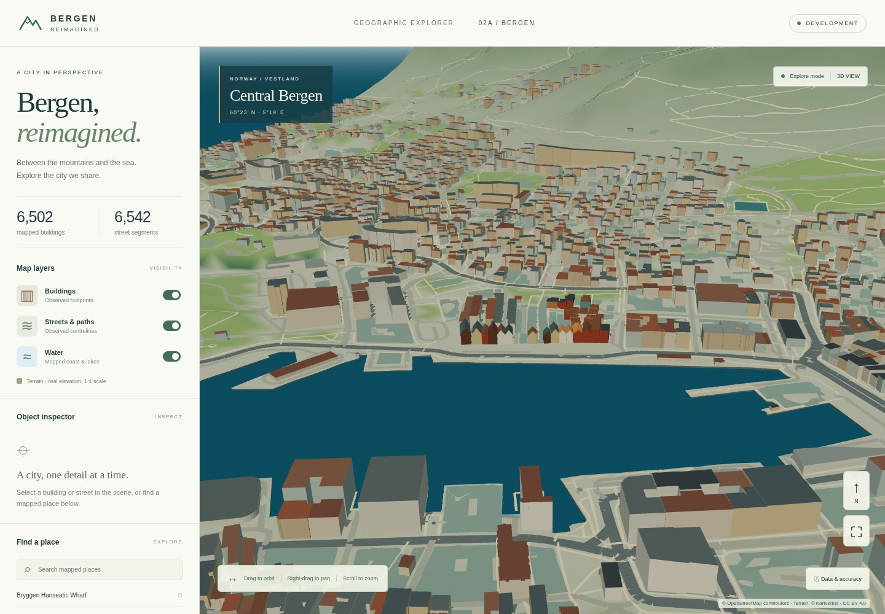

# Milestone 2A — geographic fidelity and visual quality

Baseline: `ab92713a99588dbf2458135e1bf7b41d892088a5`. One simulator-only iteration
on `feature/bergen-simulator`. No gameplay, production services, workflows or
deployment-configuration changes.

## Audit and priorities

| Baseline issue | Implemented correction, in priority order | Remaining limitation |
| --- | --- | --- |
| Bryggen / Vågen: flat roofs obscure the wharf row; pale materials weaken recognition | 15 conservative gables from explicit total/roof heights; restrained source-colour interpretation; stronger water/street contrast | Unknown heights and unsupported roofs stay unresolved |
| Terrain / Fløyen: historical tiles, coarse mesh, inconsistent draping | Dated project-specific Kartverket DTM with NN2000; 16 m display TIN; terrain-aligned road edges and building ground contact | Display mesh is coarser than the source; mapped forest coverage is incomplete |
| Bergenhus: fort grounds blend into generic terrain | Mapped park/grass colours, clearer coast/street hierarchy | Håkonshallen's source height is unknown; no fictional volume added |
| Nordnes: weak park/peninsula separation, floating coastal edges | Mapped green areas, deeper water, height-aligned coastal edges | Vertical profiles are schematic, not surveyed quays |
| City centre / Lille Lungegårdsvannet: uniform colours flatten urban structure | Retained lake outline, sampled schematic water level, mapped green areas and differentiated roofs/roads | No measured water level or material survey |
| Bridges: deck centrelines draped at ground/sea level | Retain records but omit 88 unresolved decks; keep tunnel exclusion | Verified deck heights/geometry required |
| Rendering: 39 overview draw calls, mostly water polygons | One water batch, five settled scene geometries, cheap static water tones, cached 1024px basic shadows | Physical mobile/desktop GPU profiling outstanding |

## Sources and integrity

Full acceptance checks, licensing, CRS, datum, dates, URLs and transformations:
[data sources](data-sources.md), shipped `terrain-source.json` and source manifest.

- **OpenStreetMap, ODbL 1.0:** original footprints, heights, tags, IDs, road
  centrelines, coast and water outlines are unchanged and fingerprint-tested.
  The original extracted archive is unchanged. Added green areas reuse the same
  pinned XML, retain IDs/tags/holes, and ship a separate derived ODbL extract/hash.
- **Kartverket / Høydedata, CC BY 4.0:** projects 6266 and 6282; last flights
  2022-04-18 / 2023-06-02; native EPSG:25832 / NN2000 (EPSG:5941), 0.25 m grid.
  Open-export metadata and free-product rights verified. Export restricted to
  those IDs, at 2 m in EPSG:25833. GeoTIFF CRS, resolution, complete finite
  coverage and checksum checked before inclusion. Dates describe last project
  flights, not pixels. The display has **49,313 terrain triangles** and colours
  sampled from **619 mapped green-area records**.
- Gables require explicit total height, roof height, gabled shape and a compatible
  footprint without holes. Roof height stays inside the total. Ridge direction is
  source-reported or explicitly inferred from the footprint. No unknown height
  is assigned. Existing bottom wall vertices extend to terrain for schematic
  ground contact, avoiding duplicated foundation triangles.
- Ground contact, water levels, vertical coastal finishes, materials, light, fog
  and tonal ripples are presentation approximations. Distant sea outside the
  documented crop is an illustrative backdrop, not verified offshore coverage.
  No measured quays, tides, bathymetry or facade materials are claimed.

## Fixed-camera evidence

Chromium / ANGLE SwiftShader, 1440 × 1000, DPR 1, FOV 43°. Identical camera
positions/targets are recorded in `tests/visual-views.json`. Close targets are
source-derived; camera framing is artistic. The baseline is reconstructed from a
read-only Git archive with only the same localhost capture probe added. No
checkout or branch switch. [Manifest](milestone-2a/evidence-manifest.json) includes
image and geography hashes.

| View | Before | After |
| --- | --- | --- |
| City overview | [Before](milestone-2a/before/overview.jpg) | [After](milestone-2a/after/overview.jpg) |
| Bryggen / Vågen | [Before](milestone-2a/before/vagen.jpg) | [After](milestone-2a/after/vagen.jpg) |
| Bergenhus | [Before](milestone-2a/before/bergenhus.jpg) | [After](milestone-2a/after/bergenhus.jpg) |
| Nordnes | [Before](milestone-2a/before/nordnes.jpg) | [After](milestone-2a/after/nordnes.jpg) |



## Performance impact

Single-run **software-renderer diagnostics, not hardware FPS**. Twenty alternating
overview camera steps discard four warmup samples. Frame time is JavaScript
submission; camera latency includes scheduling/software GPU backpressure, not
display scanout. Runs are sequential. Settled colour-pass counts exclude initial
creation/shadow refresh. Idle is sampled over 500 ms.

| Measurement | Baseline | 2A balanced | 2A low power |
| --- | ---: | ---: | ---: |
| Overview draw calls | 39 | 5 | 5 |
| Submitted triangles | 251,706 | 288,140 | 288,140 |
| Resident scene geometries | 39 | 5 | 5 |
| Median CPU submission | 1.1 ms | 0.9 ms | 0.4 ms |
| Median continuous camera latency | 349 ms | 457 ms | 385 ms |
| P95 continuous camera latency | 488 ms | 587 ms | 781 ms |
| Initial scene ready | 2.57 s | 3.28 s | 3.55 s |
| Idle frames | 0 | 0 | 0 |

Draw calls fall 87%; submitted triangles increase 14.5%. Balanced software camera
latency is approximately 31% higher; low power approximately 10% higher. Low-power
P95 shows run variance. Richer terrain/lighting has a measurable cost; no GPU FPS
improvement is claimed. Physical-device profiling remains necessary, especially
for sustained street-level movement.

The snapshot grows from 6,187,888 to 7,864,054 bytes (1.40 to 1.81 MB gzip).
The raster remains authoring-only. No added image textures, reflection passes,
postprocessing or animation loop. One cached shadow atlas refreshes for scene /
layer / quality changes; low power disables it. Water uses static arithmetic and
city materials use diffuse lighting. Further spatial batching is not justified
by five settled calls; the TIN sampling index serves geographic alignment.

Raw counters: [before](milestone-2a/before/metrics.json),
[after](milestone-2a/after/metrics.json), [low power](milestone-2a/low-power-metrics.json).

## Validation and reproduction

Passed: standalone build, lint, isolation, **17 Vitest + 10 release-policy tests**,
**three offline GIS tests**, fixed cameras and the [browser suite](milestone-2a/browser-report.json).
Browser checks cover WebGL, orbit/pan/zoom, merged-mesh pointer selection, source
inspection, layers, focus, 390px layout, 3× displays capped at DPR 1.5 (low power
1.0), local-only requests and explicit missing-data failure. No runtime/request
errors. Repeated pinned imports produced identical hashes. Original production
file fingerprints remain unchanged.

```sh
cd apps/bergen-simulator
npm ci
npm run lint
npm test
npm run check:isolation
npm run build
npm run preview                 # separate terminal, localhost:4180
npm run test:baseline           # disposable historical archive, port 4181
npm run test:visual
node tests/visual.mjs http://127.0.0.1:4180 after low
npm run test:browser
# With the pinned GIS venv described in data-sources.md:
python tests/importer.py
python scripts/refine-geography.py
```

Nonblocking warnings: existing large lazy Three/R3F chunk; the GIS Affine
dependency emits a pending-deprecation notice. No production pipeline changed.

## Remaining limitations and next iteration

2,878 heights remain unknown; 3,555 storey-derived heights remain estimates.
Bergenhus/Håkonshallen massing, unsupported roofs, surveyed quays and bridge decks
remain incomplete. Green-area edges interpolate display-grid samples; OSM age /
completeness, coarse terrain, flat height references on steep sites and schematic
water levels remain limits. The crop is not a seamless world.

Next: obtain an appropriately licensed Bergen FKB roof/height and bridge-deck
extract, prioritizing Bergenhus and the wharf; pair it with physical mobile /
desktop GPU profiling and loading budgets. Preserve source identity and production
isolation. Gameplay remains a later phase.
