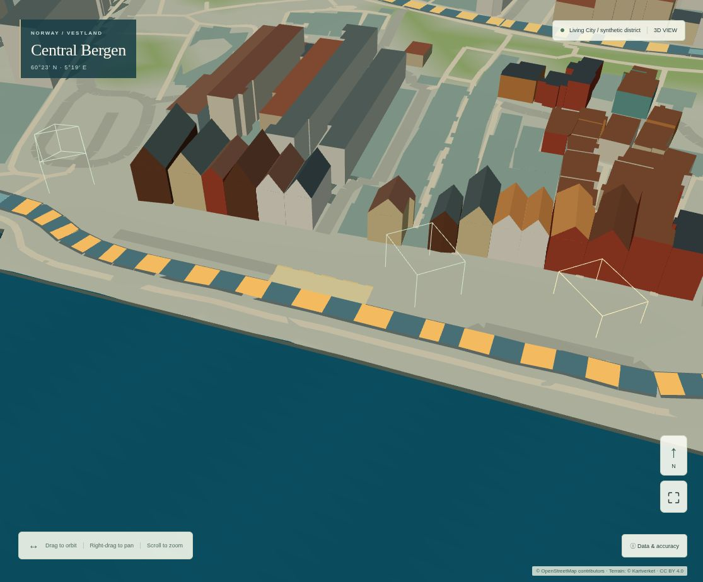
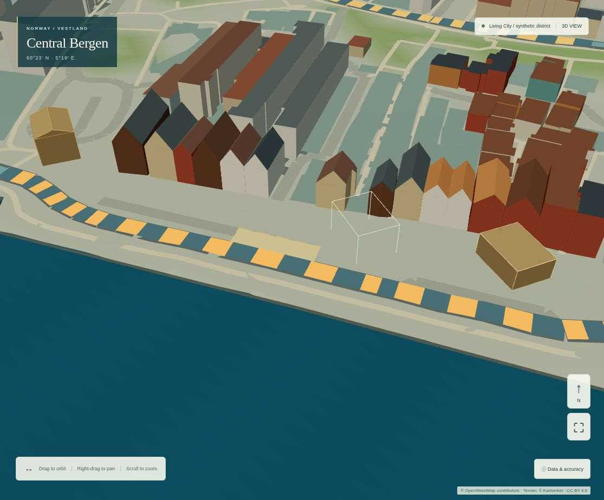

# Construction and management acceptance evidence

All outputs are synthetic for a small proposed district. PMU is fictional. Source
geography is unchanged. No actual Bergen financial or service data was imported.

## Reproduction

Use Node 24 and the committed isolated application lockfile. From
`apps/bergen-simulator/`:

```sh
npm ci
npm run lint
npm test
npm run check:isolation
npm run build
npm run preview -- --host 127.0.0.1 --port 4180 --strictPort
```

With that preview running, use another terminal to run browser suites **sequentially**:

```sh
npm run test:management
npm run test:living
npm run test:buildings
npm run test:physical
npm run test:scenario
npm run test:browser
npm run test:visual
BERGEN_EVIDENCE=1 npx vitest run tests/management.test.ts
```

The existing pinned geographic Python environment runs `python tests/importer.py`
(three offline geographic regression tests). No data-refresh/import job is needed.
The management test produces the derived 24-month comparison report. It is evidence,
not an accepted scenario input file. Import `sustainable-quarter-example.json` or
`combined-management-plan.json` to replay from month zero.

`npm run test:management-baseline` reconstructs the exact old app/harness in an
isolated temporary archive on port 4181, using the same locked dependencies, without
switching branches or changing tracked geography.

The baseline was captured before implementation on clean commit
`87ab5393b8b002208b3785897882825f58a0e495`: build and run the exact committed
`tests/living-browser.mjs`, then retain its `artifacts/milestone-5a/after` output.
The final geographic sources, terrain, cameras, CSP, viewports and renderer are
unchanged. The old construction-massing journey now explicitly imports an empty
legacy-immediate plan before authoring. This preserves its original massing tests;
the management journey separately verifies scheduled construction is the new default.
Historical browser exports now expect version 5 with explicit legacy schedules.

## Files

- `before-browser-report.json`: exact pre-implementation 5A capture.
- `before-5a-month-zero.jpg` / `before-5a-six-months.jpg`: original immediate-capacity
  district, retained separately from the new scheduled-state screenshots.
- `after-browser-report.json`: final complete desktop/mobile management journey,
  per-phase counters, command samples, worker computation, camera samples and memory.
- `first-complete-browser-report.json`: initial successful management run, retained
  rather than suppressing timing variation. Its original schedule-edit timing includes
  an explicit camera/settling wait and is not an input-responsiveness benchmark; the
  final probe measures Apply through the next observed frame after fields are filled.
- `01-planned.jpg`, `02-under-construction.jpg`, `03-operational.jpg`: fixed camera
  and source geometry; the HTML map toolbar is hidden for these canvas captures.
  Phase changes come from body index/colour updates, not labels alone.
- `04-underfunded-services.jpg`: physical 19 / funded 0 service units/month, retained
  operational building, explicit operating shortfall and unmet demand.
- `05-capital-deferral.jpg`: unreserved civic project remains planned; private
  development progresses without a public construction charge.
- `06-sequencing-comparison.jpg`: same design/demand/funding, different timing,
  comparison of households, jobs, spending and household-equivalent months.
- `07-management-challenge.jpg`: common-engine Sustainable Quarter achievement.
- `08-mobile-management.jpg`: touch viewport, contextual scheduling and time control.
- `combined-management-plan.json`: actual browser export, input-only version 5.
- `sustainable-quarter-example.json`: published, geometry-validated winning input.
- `legacy-3b.json` / `legacy-4a.json` / `legacy-4b.json` / `legacy-5a.json`: original
  unmodified examples, with default living/explicit immediate contracts only in memory.
- `strategies-24-months.json`: full early, late and underfunded input/state histories.
- `validation.json`, `manifest.json`: check results, candidate/source/evidence hashes.
- `production-isolation-pre-release.json`: read-only project/alias and main-ref
  comparators before this release. The existing municipal-politics bot independently
  advanced main and Fellestall during testing. This task did not fetch/merge that
  change or modify production; the final release report compares against the
  immediately pre-release deployment rather than claiming nothing else ran.
- Construction, public-space, street, living, explorer and fixed geographic-view
  regression reports retain the previous complete journeys.

## Measured results

Chromium 151 / ANGLE SwiftShader, DPR 1, local production build and production CSP.
The exact 5A and final 5B harnesses use the same fixed camera probes and source data.
Twelve warm samples per viewport are retained in the JSON reports. Load time includes
browser automation and scene readiness. These are individual sequential runs, not
controlled physical-device benchmarks or evidence of an FPS improvement.

| Measure | Clean 5A baseline | Final 5B |
|---|---:|---:|
| Desktop scene readiness | 3,449 ms | 3,193 ms |
| Mobile viewport readiness | 2,107 ms | 2,152 ms |
| Desktop camera median / p95 | 415.6 / 464.4 ms | 403.0 / 460.1 ms |
| Mobile camera median / p95 | 212.7 / 444.4 ms | 189.7 / 255.0 ms |
| Settled active draw calls / triangles | 11 / 289,528 | 11 / 289,528 |
| Settled active geometries / textures | 11 / 1 | 11 / 1 |
| Settled idle frames | 0 | 0 |

The earlier successful 5B run had desktop camera median / p95 419.5 / 542.7 ms
and mobile 186.2 / 210.1 ms. Timing variation is material; the final samples do not
establish a hardware performance improvement. No material persistent draw-call or
geometry growth was introduced by lifecycle rendering.

At the fixed close camera, planned / construction / operational states retain ten
draw calls and ten geometries, with 288,752 / 288,872 / 288,930 triangles respectively.
Only the existing body index range and colour buffers change. The later eleven-call
profile also includes the independently enabled traffic-intensity layer, matching
the baseline active profile. The original observed city still resets to five calls.

Six reset/replay cycles retained eleven geometries each. Post-GC main-thread JS heap
was 24,960,064 → 25,060,408 bytes (+100,344 bytes). This bounded probe cannot prove an
absence of native/browser memory leaks. The baseline retention probe used ten
geometries without the traffic layer and is not a like-for-like memory comparison.

The final complete 24-month current-plan worker calculation took 4.6 ms. The 5A
capture recorded 15.9 ms while computing current **and** saved comparison plans, so
the two figures must not be interpreted as an engine speedup. Worker time excludes
startup, transfer, main-thread validation and rendering. Six schedule-Apply commands
took 270, 505, 337, 594, 442 and 718 ms through the next observed frame; a mobile
command took 304 ms. These include Playwright interaction and worker reinitialization.
No claim about physical-device interaction latency follows from them.

The build's compressed main chunk grew from 105.46 to 112.06 kB, the scene chunk
from 247.73 to 248.18 kB, and the district worker from 12.19 to 25.95 kB uncompressed.
The existing Three.js scene chunk warning remains; no dependencies were added.

Validation: 167 application tests, 10 release-policy tests, three offline geographic
tests and all seven browser suites passed. Lint, TypeScript/Vite build, isolation and
whitespace checks passed. The 26 management tests include every archived 5A monthly
value, accounting identities, lifecycle transitions, cancelled sunk expenditure,
deferrals, operating shortfalls, malformed/stale worker output, input bounds,
challenge counterexamples, migrations, source immutability and retained GPU buffers.

## Screenshots

The same proposed district is outlined at month zero, enters construction and then
commissions according to its actual schedule. These are fictional proposed-building
states, separate from observed Bergen.





The [underfunded service view](04-underfunded-services.jpg),
[capital deferral](05-capital-deferral.jpg),
[timing comparison](06-sequencing-comparison.jpg) and
[mobile view](08-mobile-management.jpg) show the actual controls and derived outcomes.

## Developer procedure for actual hardware

This is an **optional future measurement procedure**, not a claim that physical
hardware was tested for this release. It does not alter Vercel protection, install a
bypass secret, collect user data or upload profiles.

1. Record browser/OS, actual GPU, viewport, DPR and chosen rendering quality. Close
   unrelated CPU/GPU-heavy applications. Use the same exported synthetic scenario,
   camera positions and repeated runs for a comparison.
2. For a protected hosted test, open `https://bergen-reimagined.vercel.app` in a
   browser using the normal authorized Vercel Authentication session. Keep All
   Deployments protection enabled. Use browser Developer Tools Performance/Rendering
   to record initial load, camera motion and an Apply-schedule or month-advance action.
   Inspect worker activity as a separate thread. Do not paste credentials into scripts.
3. The existing `data-worker-ms` on `[aria-label="District outcomes"]` is a diagnostic
   elapsed worker-computation total. It excludes worker startup, message transfer,
   validation and browser rendering; record those separately with the performance
   timeline. It does not affect deterministic model state or saved scenarios.
4. For renderer counters, run the same commit locally and open
   `http://127.0.0.1:4180/?capture=1` on the actual desktop. The intentionally local-only
   capture exposes `JSON.parse(document.querySelector('canvas').dataset.capture)`:
   calls, triangles, geometries, textures, bounded DPR, frames and scheduling probes.
   Use the fixed-camera events in the browser harness. Never remove the hostname guard
   to expose this diagnostic on the protected production URL.
5. On an Android test handset, USB debugging and `adb reverse tcp:4180 tcp:4180` can
   make the desktop's local preview available at the handset's localhost. Inspect with
   Chrome remote debugging on the owning computer. No public tunnel or Vercel security
   change is required. Otherwise test the hosted protected UI with built-in mobile
   browser tools; do not claim unavailable renderer counters or unaudited iOS results.
6. Record multiple warm camera/placement/commissioning samples, raw values and
   percentiles. Verify a paused, settled city produces no new frames; demand rendering
   is expected to stop rather than sustain an idle FPS number. Exercise planned,
   construction and operational phases, then repeated reset/replay and observed-city
   restoration. Check renderer geometry counts and heap after explicit GC if available.
7. Keep profiles local. Share only reviewed aggregate timings/counters and synthetic
   scene screenshots if desired. Profiles can contain browser/session information;
   neither the app nor the procedure sends telemetry or account tokens anywhere.

Software-renderer timings include scheduling/automation overhead and are not physical
GPU FPS. Small-sample p95 is sensitive to outliers. A diagnostic value by itself is
not proof of responsiveness, absence of native leaks or performance on another device.
