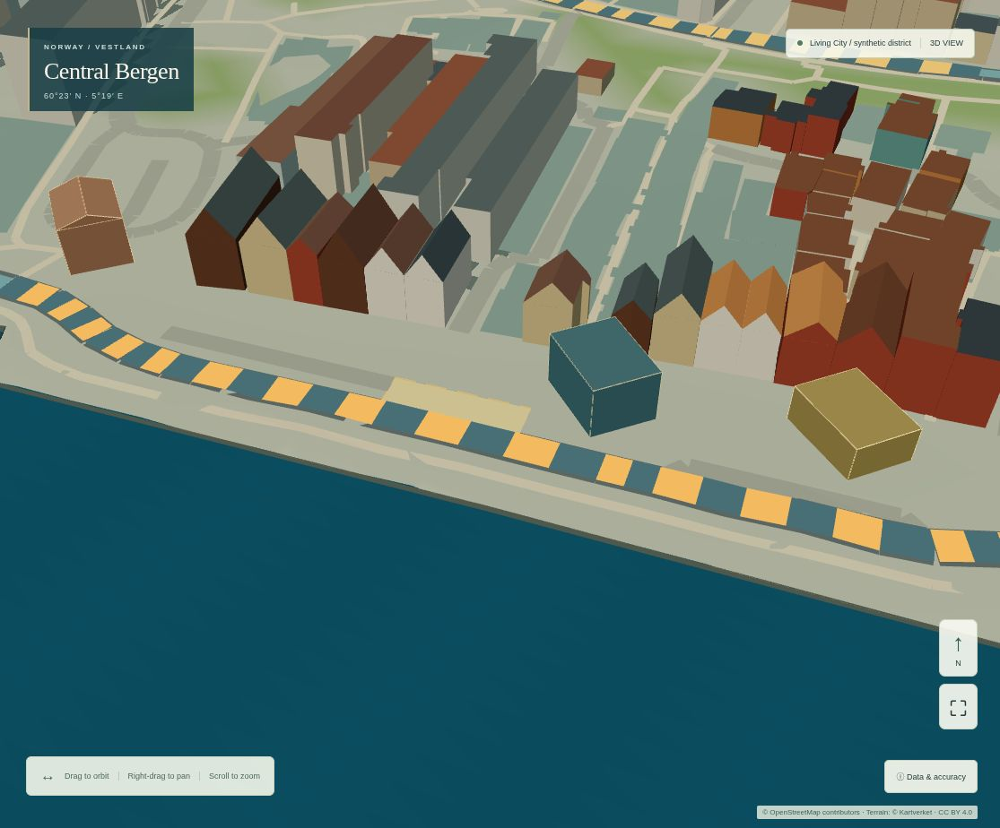

# Connected City evidence

This release improves startup CPU responsiveness and provides a source-audited offline
network candidate. District/traffic coupling is **blocked** by missing verified site
access. The active 27-way network, observed geography and version-5 scenario inputs
remain unchanged. No new trips or decorative traffic effects are added.

## Reproduction

From `apps/bergen-simulator`, Node 24 and the existing lockfile:

```sh
npm ci
npm run lint
npm test
npm run check:isolation
npm run build
python tests/connectivity-audit.py
# Existing pinned Python GIS environment:
python tests/importer.py
npm run preview -- --host 127.0.0.1 --port 4180 --strictPort
```

In another terminal, run sequentially (do not benchmark in parallel):

```sh
npm run test:connected
npm run test:management
npm run test:living
npm run test:buildings
npm run test:physical
npm run test:scenario
npm run test:browser
npm run test:visual
BERGEN_PROFILE=after npx vitest run tests/geometry-profile.test.ts
BERGEN_EVIDENCE=1 npx vitest run tests/connectivity.test.ts
```

`npm run test:connected-baseline` builds exact `c334ba6` from a temporary archive,
uses port 4181, runs its original management journey and the identical connected
profiler/geometry diagnostic. The new profiler/geometry hash fixture is copied into
that archive; the baseline **application source is unchanged**. The original 5B
baseline was captured before implementation; reports are retained here. Offline
`python scripts/audit-connected-city.py` requires the original 30 OSM tile cache
with its pinned hashes; it never downloads or refreshes geography.

Install the existing pinned `scripts/requirements-geo.txt` in an isolated Python
virtual environment for the importer tests; the new connectivity audit uses only
the standard library.

The automated browser forces Chromium 151 / SwiftShader, DPR 1, desktop 1440×1000
and touch/mobile viewport 390×844, with production CSP and local-only request checks.
It records at most 256 long tasks, 128 workers and 64 messages per worker. Measurements
include automation/scheduling overhead. No physical GPU/handset was available.

## Exact 5B vs final 5C profiler

| Measure | 5B desktop | 5C desktop | 5B mobile viewport | 5C mobile viewport |
|---|---:|---:|---:|---:|
| Scene readiness | 3,708 ms | 3,891 ms | 2,215 ms | 2,501 ms |
| Longest startup main-thread task | 906 ms | 122 ms | 874 ms | 96 ms |
| Sum of startup task time above 50 ms | 1,164 ms | 290 ms | 891 ms | 104 ms |
| Warm camera median / p95 | 428.3 / 904.0 ms | 388.4 / 467.6 ms | 207.1 / 246.1 ms | 203.1 / 238.1 ms |
| Reset/replay retained geometries (five cycles) | 10 each | 10 each | 10 each | 10 each |
| Post-GC main-thread heap change | −1,356 B | +552,828 B | +48,428 B | +149,156 B |
| Schedule command-to-ready | 740 ms | 673 ms | 700 ms | 636 ms |
| Undo / redo command-to-ready | 631 / 625 ms | 574 / 636 ms | 278 / 454 ms | 506 / 399 ms |
| Two scenario switches | 77 / 317 ms | 313 / 300 ms | 62 / 140 ms | 72 / 197 ms |
| Settled idle frame change | 0 | 0 | 0 | 0 |

A previous successful 5C probe is retained: desktop readiness 3,753 ms, longest
startup task 126 ms, camera median/p95 403.8/452.7 ms; mobile readiness 2,190 ms,
longest task 104 ms, camera 254.2/291.8 ms. The slower first mobile-camera probe was
investigated against unchanged attribute hashes, draw calls/triangle counts and
bounded CPU instrumentation. The repeat did not reproduce that latency increase.
This variation does **not** establish a physical-GPU improvement or regression.

The robust finding is removal of the approximately 0.9-second synchronous geometry
startup task. Total readiness is not improved: an extra worker script, source clone
and main validation/hydration are real costs. The worker adds ~143.34 kB uncompressed
JavaScript; the main compressed chunk is ~112.95 kB and scene ~248.02 kB. Main-thread
hydration remains about 0.1 seconds. Further worker/clone and native-device profiling
is appropriate before increasing source coverage.

Command timings include Playwright click/fill/scroll, worker restart, validation and
status update, not just model processing or a guaranteed presented GPU frame. They
vary substantially between runs. Resource/worker/long-task arrays retain raw values
for inspection; no unsupported claim of universal interaction speedup is made.

Five static layers retain the exact 5B attribute hashes and 27,048,522 bytes. New
capture fields count retained geometry attribute/index arrays and bytes, not measured
native VRAM. Instancing/object uniforms and driver allocations are excluded.
The profiler's planned-state replay uses ten geometries without the traffic layer;
the complete management journey also profiles the existing independent traffic layer.
The geometry worker terminates after its single reply; reset/scenario/undo operations
do not rebuild the observed city. Main-thread heap checks do not measure worker peak
heap or prove absence of native leaks.

## Evidence files

- `before-profile-browser-report.json`: identical profiler on exact 5B application.
- `after-profile-browser-report.json`: final complete profiler including switching,
  undo/redo, playback, worker lifetime, raw camera/long-task/CPU/heap measurements.
- `first-profile-browser-report.json`: initial successful worker implementation probe,
  retained to expose timing variation rather than select only favourable samples.
- `before-management-browser-report.json` / `after-management-browser-report.json`:
  original complete construction/finance gameplay journey before and after changes.
- `before-geometry-profile.json` / `after-geometry-profile.json`: Node CPU phases and
  byte-exact layer hashes; not a browser or physical-device performance measurement.
- `before-operational.jpg`, `after-operational.jpg`: unchanged proposed/observed geometry.
- `desktop-connected-status.jpg`, `mobile-connected-status.jpg`: month-24 gameplay
  captures after the profiling sequence. The access readout may be below the viewport.
- `desktop-access-readout.jpg`, `mobile-access-readout.jpg`, `mobile-district-world.jpg`:
  dedicated access-status evidence and the same proposed district, without implying
  a simulated site connection.
- `transport-audit.json`: all 366 reviewed highway records/exclusions, entrance/source
  memberships, site evidence, original source checksums and coverage limitations.
- `transport-candidate-source.json`: ODbL offline 48-way candidate; no runtime activation.
- `candidate-network-report.json`: deterministic, demand-conserving common-engine
  comparison, with unchanged 960 synthetic requests in a representative 30-minute period.
- `authoritative-source-review.json`: exact official catalogue/licence-reference URLs,
  retrieval dates/status/checksums and selected metadata; no new geography was imported.
- `validation.json`, `manifest.json`: acceptance checks, tested app/evidence SHA-256s.
- Remaining regression reports retain living, building, public-space, street, explorer
  and fixed geographic-view acceptance. Geometry hash tests pin exact 5B data buffers;
  management tests retain exact legacy monthly outputs and versions 1–5 compatibility.

For native hardware use the [physical-device procedure](physical-device-profiling.md).
Hosted Authentication remains enabled. Local capture diagnostics are intentionally
unavailable on the protected production hostname.

## Rendering preservation

The operational before/after JPEGs are byte-identical, as are the five static geometry
attribute hashes. The common management journey retains 11 draw calls, 289,528
triangles, eleven geometries and zero idle frames with independent traffic intensity.
Six reset/replay cycles retain eleven geometries each. District worker computation
was 7.3 ms in the baseline run and 5.6 ms afterwards; both are short, variable samples
of the unchanged engine, not evidence of a model speedup. In that journey mobile
scene readiness was 2,118 → 2,424 ms and camera median/p95 231.7/263.5 → 201.0/251.3 ms.
The extra worker is a responsiveness tradeoff, not an assured faster load.

| 5B operational district | 5C operational district |
|---|---|
|  |  |

Dedicated readout reproduction, after starting the local preview:

```sh
node tests/capture-connected-evidence.mjs
```
