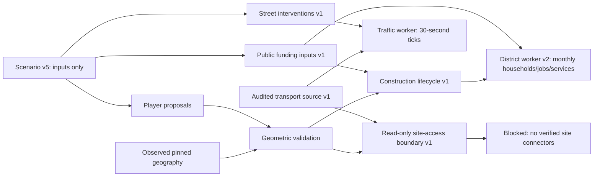

# Milestone 5C — The Connected City: preparation and verified boundaries

Baseline: `c334ba6ad0caedd90b6706d34c004a833d7f7dd5` (5B). This iteration improves
startup responsiveness and audits a bounded transport extension. It deliberately
leaves district activity and traffic independent because proposed-site access is
not supported by the pinned sources. No fictitious entrance, driveway, destination,
vehicle demand or decorative traffic animation was introduced.

## Performance investigation and changes

The exact 5B application was built and its complete management journey replayed
before changes. An identical local browser profiler was then run on 5B and 5C. It
records scene readiness, resource timings, main-thread long tasks and CDP CPU/heap
metrics, command-to-ready timings, worker lifetime/first-reply/processing timings,
camera probes, repeated reset/replay retention and settled idle frames. The new
stage instrumentation is available only on localhost with `?capture=1`.

A Node geometry diagnostic identified merged building preparation as the largest
CPU phase: approximately 646 ms before changes, versus 112 ms roads, 19 ms terrain
indexing and 13 ms terrain construction. This is a CPU diagnostic, not GPU evidence.
The rendered building vertices require 245,253 terrain-height samples; only 989
lack a TIN sample. Previously every vertex searched all footprint corners for an
unused fallback. The fallback is now evaluated only when the TIN returns null.
All five layers' position/normal/colour/index hashes remain **byte-identical** to 5B.
The single-process after diagnostic recorded 588 ms buildings; process/run variance
means this small timing difference alone is not a controlled speedup estimate.

The first paired browser probe observed a 906 ms desktop / 874 ms mobile-viewport
startup long task. This justified a dedicated one-shot geometry worker. It prepares
five unchanged merged batches, computes their bounding spheres and transfers typed
attribute/index buffers. The main thread validates and hydrates the buffers and
reattaches source features by their exact ordered IDs. No source data or feature
records are transferred away from the main thread. There is no worker render loop.

The first 5C probe reduced the longest startup task to 126 / 104 ms, with scene
readiness approximately unchanged (desktop 3,708 → 3,753 ms, mobile 2,215 → 2,190 ms).
Hydration/validation still took approximately 92–100 ms on the main thread. Worker
preparation, clone/startup/transfer and main-thread validation are separately labelled;
the combined first-reply measurement must not be called pure worker boot time.
Final raw measurements and variation are recorded in the evidence guide.

The new worker adds approximately 143 kB uncompressed JavaScript and a temporary
structured clone of the pinned source. Its five output batches total 27,048,522
attribute/index bytes. This is a tradeoff for reduced main-thread blocking, not a
claim that startup is faster or that native memory falls. The worker is terminated
after completion/error/cancellation and has a 30-second deadline. Replacement and
late-result handling are tested. Main-thread retained buffers are disposed exactly
once on scene cleanup. Missing/invalid preparation fails explicitly; it never loads
invented geography or silently falls back to blocking preparation.

Limits: 10,000 buildings and 10,000 roads, 300,000 terrain position values, 500,000
terrain index values, 500,000 total building/road/water/coast points, 32 rings per
building, 1,000 water/coast records, at most 64 MiB output attributes, five batches
and bounded diagnostic entries (128). Position/normal/colour arrays must be finite
Float32 arrays with matching counts; indices, bounds and source feature ranges are
validated before GPU allocation. These are infrastructure guards, not new geography.

### Optimizations deliberately deferred

Spatial tiling/culling would split five observed-city passes, change selection
batching and add lifecycle complexity. The city-wide draw-call count is already low.
Software-renderer camera latency alone does not establish the tile size or culling
benefit on a real GPU. No tiling, LOD, continuous animation or new effects were added.
The measured synchronous preparation defect was addressed first. Physical-device
GPU responsiveness, native GPU memory and worker peak heap remain unverified.

## Geographic investigation

`python scripts/audit-connected-city.py` reads the **complete original 30-tile OSM
cache**, verifies every checksum against the unchanged source manifest, and refuses
an incomplete/unpinned cache or inconsistent duplicate source records. It never
writes `public/data/`. OSM acquisition remains 2026-10-16; this is a new audit and
derivative candidate, not a live source refresh.

Review window: local x −200…200 m, z −460…20 m around the existing Bryggen authoring
sites. The selection includes highway ways with at least one retained source node
inside the window. A crossing-only way can be missed; this is **not a complete road
inventory**. Whole-way inclusion is required for new candidates; roads are never cut
at an invented boundary node. Original model ways are retained in the candidate union.

The cache contains 121,766 nodes, 16,471 ways and 73 restriction relations. The
window selection contains 366 highway ways: 224 footways, 23 steps, 20 pedestrian
ways, 27 service ways, four living streets, four paths, two cycleways, four platforms
and 58 primary/secondary/tertiary/unclassified ways including links. The audit
retains original tags and IDs and lists exclusions individually.

Sixteen tagged entrance nodes occur in the window. Their original building/highway
way memberships are reported. A door to an observed building is not an entrance to
a new hypothetical building. None of the three sample proposals has a verified site
entrance and route to the motor graph. The closest current source node is about
17–21 m away and the nearest entrance about 26–68 m away; these distances are
**diagnostics only**, never connector evidence.

### Bounded offline graph candidate

Thirty-seven whole motor-road candidates survive the window checks, including
21 ways outside the existing model. Their union with all original 27 ways yields
an offline candidate of **48 ways, 51 graph nodes and 95 directed edges**. The
candidate source preserves original coordinates, node IDs, way directions and node
tags. Its active original subgraph is unchanged. All candidate node references are
validated and all original restriction relations checked: none involves the admitted
union. The common engine builds and exercises this candidate deterministically.

The same synthetic 960-request, 30-minute demonstration demand routes 960 trips and
zero unrouted in both graphs. Vehicle-minutes are the same to floating-point
rounding (~1,938.24); additional streets do not imply additional district demand.
This is a topology/engine compatibility check, not evidence that traffic improved.

The candidate is an **offline review artifact**, not an enabled map/network option.
It does not replace the source ID bound to legacy plans. Boundary continuation,
site access, mode eligibility and lane/turn interpretation still need a separate
source/model review before activation. Current routing and all saved outcomes keep
the 27-way source. No player is offered a nonfunctional expanded-network control.
Replacing that source would change the network identifier bound into existing plans.
With no verified site connectors and no meaningful change to the current OD example,
introducing a new persisted network option/migration would add compatibility costs
without enabling the requested connected-city gameplay. Activation remains an
explicit next-phase decision rather than a silent legacy-source replacement.

### Access and topology safeguards

- Shared original node IDs establish graph intersections; overlapping coordinates,
  crossing lines and nearest-road distances never create a junction.
- Missing nodes, duplicate identities, unsupported loops/directions, unreviewed
  bridge/tunnel/layer/junction semantics and conditional access are rejected.
- Mode-specific motor access tags are checked against a conservative whitelist;
  explicit no/private tags and complex overrides require review. Node barriers
  and access restrictions require review. Bicycle contraflow does not reverse car
  directions. Service, pedestrian and living-street classes are not automatically
  promoted to unrestricted car roads.
- The engine has no turn-state router. New nonempty relation/restriction inputs now
  fail closed rather than being silently ignored. A future graph containing such
  relations needs an explicit turn-aware implementation or justified exclusions.
- OSM absence of a relation is not a guarantee of real-world legality. Lane guidance,
  time-dependent rules, missing barriers and mapping omissions remain limitations.
  Existing aggregate traffic assumptions and player interventions remain synthetic.

## Sources, licensing and integrity

| Source | Use in 5C | Rights / coordinates / integrity |
|---|---|---|
| Pinned OSM API 0.6 30-tile cache | Offline topology, entrance and restriction review; derivative candidate | © OpenStreetMap contributors, ODbL 1.0, attribution/share-alike retained. Original EPSG:4326 nodes; no verified vertical datum inferred. All tile hashes and original IDs retained. |
| Existing Kartverket DTM / Høydedata | Unchanged terrain and placement foundation | Existing CC BY 4.0 provenance, project acquisition dates, NN2000 vertical datum and checksums remain in `terrain-source.json`; no terrain download/revision. |
| [NVDB Vegnett catalogue](https://kartkatalog.geonorge.no/metadata/ad17eb84-b6b7-4fd1-99d9-b1b920421705) | Authoritative-source metadata investigation only | Catalogue says it replaces Forenklet Elveg 2.0 and contains road links/barriers; “no restrictions” access metadata. No geometry acquired or adopted. Redistribution licence, requested CRS/datum, site entrance linkage and local topology still require review before use. |
| [FKB-Bygning catalogue](https://kartkatalog.geonorge.no/metadata/8b4304ea-4fb0-479c-a24d-fa225e2c6e97) | Metadata investigation only | Entry describes 2.5D buildings, not a ready site-access graph, and has “norway digital restricted” access metadata. No data/licence entitlement assumed; no geometry acquired. |

Official metadata/OSM licence references were retrieved 2026-10-17; URLs, timestamps,
response status and hashes are retained. Initial broad Elveg search returned unrelated
Elvegårdsmoen results and was not used as evidence; the refined query identified NVDB
Vegnett. The initial NVDB root request returned a documented User-Agent requirement,
not a geometry dataset. Neither a WMS depiction nor open catalogue access establishes
redistribution rights, routable site entrances or transport completeness.

See the [source audit](milestone-5c-evidence/transport-audit.json),
[candidate source](milestone-5c-evidence/transport-candidate-source.json) and
[engine comparison](milestone-5c-evidence/candidate-network-report.json).

## Explicit subsystem boundaries

The geography model never receives hypothetical edits. Proposed geometry is validated
against the source snapshot; management inputs determine operational capacity; the
existing district engine determines monthly stocks and funded civic utilization.
The traffic engine receives only its original bounded OD inputs and explicit street
interventions. The access assessment returns a versioned, read-only blocked status
and **zero added requested trips**. A centroid moved exactly onto a graph node still
does not establish a source-supported entrance.

No trip-generation coefficients or monthly-to-30-minute conversion were introduced:
without defensible origins/destinations they would imply connectivity that is missing.
Monthly stocks are not monthly journeys and are not divided by a month to manufacture
a half-hour OD table. A future opt-in contract must specify a representative period,
bounded rates/network share, verified endpoints and allocation/conservation rules.

The geometry worker protocol v1 is transient, separate from scenario imports. Source
IDs reconnect pick ranges to existing main-thread features; no arbitrary meshes,
materials, executable values or replacement geography are accepted from saved plans.
Worker lifetime and resource ownership are explicit. There is no new runtime service,
database, telemetry or credential.

## Compatibility, acceptance and next phase

Scenario version **5 remains current**: no new persisted simulation inputs are needed.
Versions 1–5, local library/save/reload, duplicate, import/export, comparisons and shared
undo/redo remain. New purported trusted access/connectors/derived results are rejected.
Unchanged strategies reproduce their original district and traffic outcomes. The
existing complete construction/management browser journey remains part of acceptance.

Tests include source checksums, candidate connectivity, shared IDs, one-way direction,
unsupported turn/access/grade/node-barrier rejection, traffic-demand conservation,
blocked site access despite proximity, changed district activity with unchanged
traffic, exact geometry hashes, transfer detachment, malformed buffers/source ranges,
stale/cancelled workers, deadlines/disposal, local-only bounded instrumentation,
scenario switching/undo/redo/playback and desktop/mobile settled rendering.

See [evidence and reproduction](milestone-5c-evidence/README.md) and the
[physical-hardware procedure](milestone-5c-evidence/physical-device-profiling.md).
No physical desktop/mobile GPU was available; hardware performance remains unverified.

Next: profile native GPU responsiveness/peak memory, then review source-supported
site-boundary access and the candidate network's continuation/turn semantics. Only
after those gates should a separate opt-in transport-input contract connect monthly
stocks to a representative 30-minute scenario. Do not expand nationwide or infer
connections from proximity.
