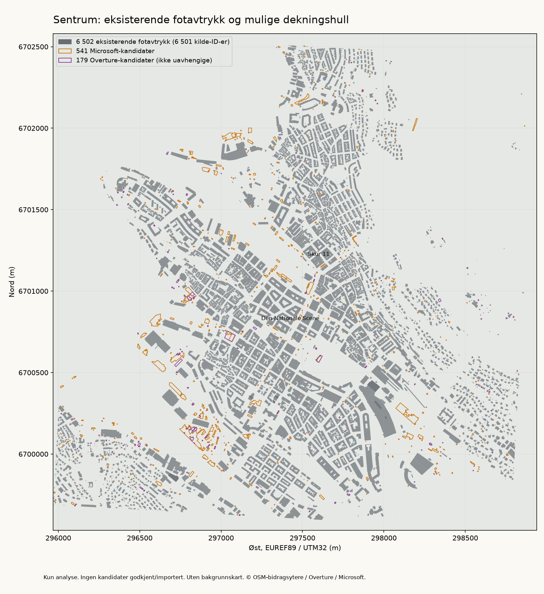
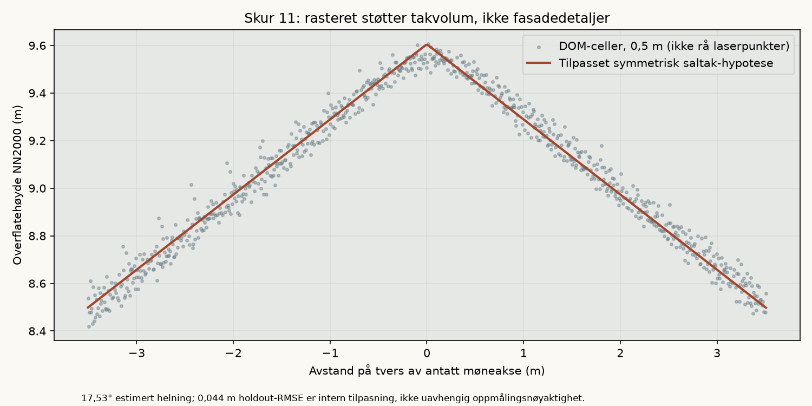
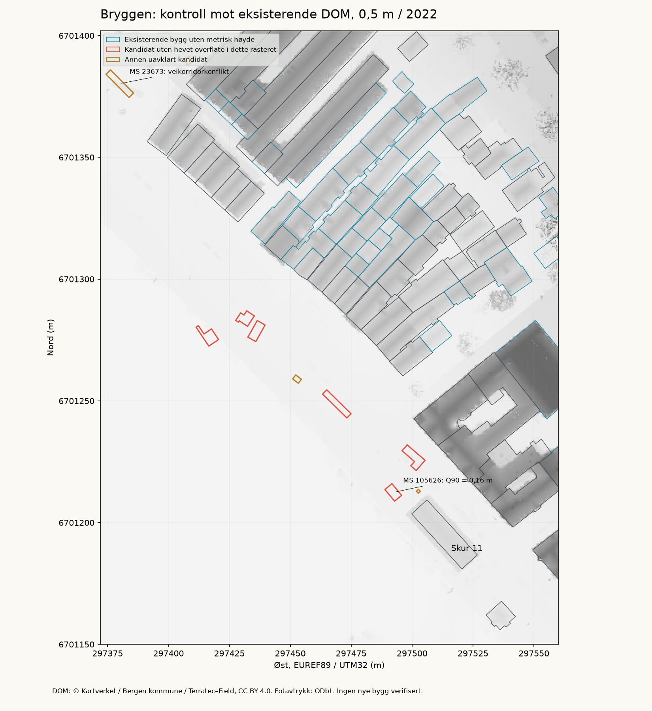
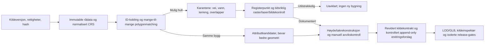

# Missing Buildings Reconstruction Pipeline — Bergen sentrum

Undersøkelse og avgrenset, kjørbar prototype, **19. oktober 2026**.
Utgangspunkt `c1a11323828c4201f3fdf219f0b1bcef3cb75d60`, renderer R1C.
Kun `feature/bergen-simulator`; ingen geografisk revisjon eller masseimport.
Dette utvider [rekonstruksjonsstrategien](architectural-reconstruction-strategy.md).

## Anbefaling

Bygg en **kildestyrt kandidatpipeline med karantene**, ikke en automatisk erstatning
av dagens bygningslag. Bruk Overture til kildekobling og første hullsøk, Microsoft
som supplerende detektor, åpne bygningspunkter som uavhengig kontroll, og Kartverket
DOM/DTM eller klassifisert laser til høyde-/takhypoteser. Behold kjente fotavtrykk
og ID-er. Prioriter høydeberiking av eksisterende bygg før import av nye volum.

For automatisk takrekonstruksjon anbefales **PDAL + roofer** når klassifisert laser
og egnede takavgrensninger foreligger. **3dfier** er et enklere LoD1-alternativ.
**OSM2World** er et verktøy for skjematisk presentasjon av data vi allerede har;
det oppdager ikke manglende bygg og kan ikke dokumentere ukjent arkitektur.
Fasader uten kildebelegg skal fortsatt være tydelig skjematiske.

Prototypen finner konkrete romlige avvik, men **godkjenner ingen nye bygg**.
Antall kandidater er ikke et mål på faktisk manglende bygninger. Båter, telt,
vegetasjon, takoverheng, sammenslåtte bygg og endringer mellom dataepoker kan gi
falske funn. Vi har ikke et uavhengig komplett fasitdatasett for dagens Bergen.

## Målt dekning og usikkerhet

Samme utsnitt i alle tellinger: WGS84 **[5.298, 60.382, 5.349, 60.408]**.
Objektets tyngdepunkt må ligge innenfor utsnittet; avstand/areal/overlapp beregnes
i EUREF89 / UTM32, EPSG:25832. Rå koordinater beholdes i kildeformatet.

| Mål | Dagens modell | Microsoft, tilgjengelig eldre flis | Overture 2026-09-23.1 |
|---|---:|---:|---:|
| Fotavtrykk i sammenligningsutsnittet | 6 502 | 2 947 | 6 721 |
| Direkte ID-treff mot dagens modell | — | Ingen slike kilde-ID-er | 6 462 |
| Andre romlige treff | — | 2 109 | 13 |
| Uavklart overlapp / avstand under 2 m | — | 296 | 67 |
| Romlig atskilte hullkandidater | — | 541 | 179 |
| Ugyldig kildepolygon, ikke reparert/importert | — | 1 | 0 |
| Kandidater uten de definerte maske-/arealkonfliktene | — | 162 | 110 |
| Av disse uten >20° helningsflagg i grov DTM-kontroll | — | 129 | 81 |
| Godkjente nye bygninger | — | **0** | **0** |

Microsoft- og Overture-kandidatene **skal ikke summeres som unike bygg**.
Alle 162/110 maskeukonfliktede kandidater har Microsoft som geometriopphav.
Overture er en sammensatt database: 6 507 geometrier her kommer fra OSM, 214 fra
Microsoft. Samme geometri gjennom to leverandører er ikke to uavhengige bevis.

Dagens 6 502 fotavtrykk har **6 501 unike kilde-ID-er**. Broegelmannhuset,
`relation/5903565`, består av to atskilte polygonkomponenter med samme kilde-ID.
Dette er bevart, ikke «fikset» ved å finne på en ny observert bygningsidentitet.
En lavere Microsoft-telling skyldes blant annet ulike avgrensninger og
sammenslåinger; den viser ikke at vi bør slette tusenvis av OSM-bygg.

Median beste IoU blant romlige/ID-treff er 0,4600 for Microsoft og 0,9992 for
Overture. Det første omfatter mange-til-mange-avgrensninger; det andre gjenspeiler
i stor grad samme OSM-opphav og avrunding i dagens lokale koordinater. Ingen av
tallene er målt nøyaktighet mot oppmåling eller sann dekningsgrad.

## Konkrete avvik som kan etterkontrolleres

Alle koordinater under er hentet fra kandidatenes geometri, ikke håndplasserte
erstatningsbygg. Overture-radene har Microsoft-geometri og står i karantene.
De er gode prioriteringer for kontroll, ikke bekreftede byggeprosjekter/adresser.

| Kandidat / originalidentifikator | Tyngdepunkt lon, lat | Areal | Funn / beslutning |
|---|---|---:|---|
| Overture `bf8cda4a-2d01-48cc-b7d2-0e2e1eb639c1` | 5.3104247, 60.3946679 | 114,73 m² | Ingen enkel maskekonflikt, grov helning 1,17°. Nærliggende registerpunkt har IG-status og ligger utenfor polygonet. Ingen bekreftet bygningsidentitet |
| Overture `16c376e2-ddb8-4054-be8d-42a577771af0` | 5.3121571, 60.3940185 | 344,66 m² | Grov helning 2,20°. To registerpunkter inne i polygonet: IG og GR. Livsløps-/tidskonflikt, ikke godkjent import |
| Overture `7eb0b26f-0b54-4ca4-8b51-6c22120175f9` | 5.3118522, 60.3937761 | 399,10 m² | Grov helning 3,18°. Ett punkt med IG-status inne i polygonet. Ikke dokumentasjon på ferdig bygg eller riktig omriss |
| Microsoft flis 120020133, linje 105626, råpost-hashprefiks `7f1f9bdc1472d040` | 5.3240342, 60.3964232 | 23,32 m² | Ingen enkel maskekonflikt, men 41 DOM-celler gir Q90 kun **0,158 m** over bakken i 2022. Ikke støttet som et bygningsvolum av dette rasteret |

Den siste raden er særlig viktig: geometri uten kollisjoner er ikke bevis for at
et bygg finnes. En senere oppført struktur kan heller ikke utelukkes med et eldre
raster. Tidskonflikten må undersøkes; vi oppretter ikke et nytt bygg for å fylle hullet.
Fullstendige lister med kilde-ID, nærmeste eksisterende ID, geometri og årsaker:
[kandidater](missing-buildings-research-2026-10-19/candidates.geojson.gz),
[triage](missing-buildings-research-2026-10-19/candidate-triage.json.gz).

### Uavhengig, begrenset registerkontroll

Fire små kandidatutsnitt ble faktisk forespurt i Kartverkets åpne WFS etter
kontroll av eksplisitt CC BY 4.0-lisens. Vi beholdt bare bygnings-ID/nummer, status,
punkt, oppdateringsdato og markering av verifisert stedfesting; ingen eierskap,
adresser eller bruksenhetskoblinger er lagret i studien.

Ved de tre Overture-kandidatene returnerte tjenesten til sammen åtte punkter;
tre lå inne i kandidatpolygonene, men ingen av disse hadde status TB/MB/FA.
**IG** er igangsettingstillatelse, **GR** er godkjent for riving/brenning, ikke
bekreftet riving eller et komplett, faktisk nybygg. GR brukes heller ikke til å
slette eksisterende geometri. [Kartverkets føringsinstruks](https://www.kartverket.no/globalassets/eiendom/matrikkel/foeringsinstruks-matrikkelen.pdf)
og [byggtema](https://www.kartverket.no/geodataarbeid/forvaltning-drift-og-vedlikehold/byggtema)
underbygger skillet. Selv et ferdig-statuspunkt ville vært støtte, ikke et målt omriss.
Ved den undersøkte Microsoft-kandidaten nær Skur kom ingen registerpunkt i den
lille kontrollboksen; dette er ikke bevis på at alle uregistrerte strukturer mangler.

En først forsøkt full-utsnittforespørsel ble avbrutt ved 15 MB; ingen full register-
dekning hevdes. Ingen av de fire små svarene nådde vår 50-objekters sikkerhetsgrense;
de er likevel ikke en uavhengig fullstendighetsgaranti eller sentrumstelling. WFS ignorerte
egenskapsprojeksjonen og rapporterte upålitelig `numberReturned`; koden teller
faktiske medlemmer, kontrollerer CRS/bounds og lagrer bare de valgte feltene.
[Registerresultater og originale ID-er](missing-buildings-research-2026-10-19/registry-results.json).

## Bygg uten høyde og takopplysninger

Dagens modell har 69 mapperoppgitte meterhøyder, 3 555 eksisterende
`etasjer × 3 m`-estimater og 2 878 ukjente høyder. Bare 411 fotavtrykk har
`roof:shape`, og 26 har `roof:height`. Ukjent høyde er fortsatt `null`.
R1B/R1C har egne detaljerte assets for sju bygg; tellingene her beskriver
det uendrede geografiske grunnlaget, ikke alt det separate asset-laget.

Overture har 1 579 positive høyder i det sammenlignbare utsnittet. Ved direkte
OSM-ID-kobling finnes 1 306 Microsoft-beregnede høyder: **679** til ID-er med
ukjent høyde og **627** til ID-er som nå bare har etasjeestimat. De 69 øvrige
direkte koblede høydene viderefører OSM. Dette er en realistisk berikingsmulighet,
men Microsoft-høyde er en ML-beregning, ikke lasersurvey eller målt mønehøyde.
Ingen attributter ble skrevet til kildegrunnlaget.

### Faktisk kjørt DOM/DTM-test

Den allerede låste **0,5 m DOM-cropen** ved Bryggen dekker 72 eksisterende
fotavtrykk fullstendig, inkludert **34** med ukjent høyde. Mot den eksisterende
2 m DTM-en gir alle 72 en forhøyet overflate. Vi lagrer Q10/Q50/Q90 av
`DOM − DTM` som høydekandidater, ikke en autoritativ totalhøyde.

For nær-rektangulære bygg testes et plan og et symmetrisk saltak. En romlig
sjakkbrettdeling holder rasterceller utenfor tilpasningen. **21 saltakhypoteser**
består den eksplisitte rasterscreeningen uten konflikt med registrert takform;
**51** bygg får ikke et godkjent enkelt takforslag. Ett av disse 51 passer
matematisk som saltak, men har OSM-tag `hipped`: kildekonflikten stopper forslaget.
Verken god tilpasning eller mange celler dokumenterer skjulte bygningsdetaljer.

Eksempler på høyde-/takhypoteser for nå høydeukjente bygg:

| Eksisterende OSM-ID | Q90 over terreng | Rasterstøttet formhypotese |
|---|---:|---|
| `way/331274536` | 12,531 m | Symmetrisk saltak, estimert 47,77°; møneakse utledet fra fotavtrykket |
| `way/331274546` | 12,545 m | Symmetrisk saltak, estimert 43,63° |
| `way/331274552` | 17,290 m | Ingen støttet enkel takform; høydeestimat alene |

For Skur 11 gir kontrollen omtrent **17,53°** og møne **9,605 m NN2000**.
Holdout-RMSE er 0,044 m mot samme raster, ikke centimeterpresisjon mot bygget.
Q90 over DTM er 7,677 m og er en annen størrelse enn absolutt mønekote.
Den eksisterende kildebaserte R1C-modellen erstattes ikke av dette forsøket.

Ti hullkandidater ligger helt i DOM-cropen: seks mangler forhøyet overflate i
2022-dataene; tre er for små/smale for tilstrekkelig sampling; én har en forhøyet
overflate, men konflikt med en kartlagt veikorridor. **Ingen blir et godkjent nytt
bygg.** Dette demonstrerer kontrollslusen i praksis.

**Rå LiDAR, 3dfier og roofer er ikke kjørt.** Den offentlige dokumenterte
LAZ-eksporten krever `CopyEmail` når BAAT-bruker mangler; vi oppretter ikke en
identitet, sender e-post eller bestiller på vegne av en ukjent mottaker.
Et separat, avgrenset DOM-forespørselsforsøk for større sentrum returnerte HTTP
503. Denne leveransen bruker derfor eksisterende, verifiserte rasteroriginaler.
Fullby-LiDAR-dekning eller LoD2-nøyaktighet er ikke dokumentert av denne testen.

## Rangert teknologivalg for dekning og volum

| Prioritet | Løsning | Bruk og arbeidsmengde | Begrensning |
|---|---|---|---|
| 1 | Bevar egne kilde-ID-er + Overture/GERS + romlig matching | Lav automatisk kostnad; kildevis kandidat-/attributtberiking, menneskelig kontroll av avvik | Sammensatt opphav; eldre OSM-utgave; ikke uavhengig fasit |
| 2 | Åpne bygningspunkter + Kartverket DOM/DTM/klassifisert laser | Prioriterer faktisk registrerte strukturer; høyder og tak får fysisk kildegrunnlag | Punkter er ikke omriss; luftbåren datafangst ser ikke alle fasader; epoker må stemme |
| 3 | PDAL + **roofer** | Skalerbar punktskytilrettelegging og LoD2.2-tak; mye kan batch-kjøres | Krever rå, klassifiserte bygg-/bakkepunkter og godt samsvar med takavgrensningen. Ikke benchmarktestet her |
| 4 | Microsoft Global ML Building Footprints | Supplerende hull-/takavgrensningsdetektor med lav maskinkostnad | Lokalt tydelige avvik, sammenslåinger og objekter på vann/vei. Undersøkt eldre flis har ingen positive høyder |
| 5 | **3dfier** | Enkel LoD1-løfting av kjente flater fra punktsky; mindre arkitektonisk arbeid | Typisk percentilhøyde/enkelt volum, ikke full tak- og fasaderekonstruksjon |
| 6 | **OSM2World** | Rask, kildeidentifisert bakgrunnseksport til GLB | Finner ikke bygg uten input; standardvinduer og høyder er ikke fakta. Skur-forsøket i forrige studie ble avvist som erstatning |
| 7 | SAM 2 / oppgavespesifikk segmentering, kontrollert AI-dybde | Forslag fra eksplisitt lisensierte bilder; kan redusere sporingsarbeid | Segmenter er ikke verifiserte fotavtrykk, og dybde uten kalibrering er ikke oppmålt. Ikke kjørt eller trent her |

FKB-takkanter/mønelinjer kan bli bedre inngang enn ML-fotavtrykk når en konkret
leveranse er klarert. FKB er ikke generelt fritt bare fordi Kartverket distribuerer
andre åpne produkter. GlobalBuildingAtlas er et interessant alternativ, men
publiserer nå polygoner/LoD1/høyder med **ulike lisenser**, inkludert NC for viktige
produkter. Ingen NC-høyder eller modeller er tatt inn.
Detaljerte rettigheter og produksjonsegnethet:
[kilderegister](missing-buildings-research-2026-10-19/source-register.md).

## Automatisert prosess før fremtidig import

1. **Anskaffelse:** oppgi publisher, URL, kildeversjon/epoke, original-ID, lisens,
   kommersiell bruk/hosting, attribusjon, CRS, høydedatum, råhash og avgrensning.
   En filhash beskytter vår kopi, men er ikke utgivers digitale signatur.
2. **Matching:** prioriter direkte kildeidentitet, men flagg geometrisk drift.
   Test polygoninterseksjon/IoU og avstand; håndter hull, deler, sammenslåing,
   takoverheng og faseforskjeller. Ikke flytt et eksisterende bygg til nærmeste
   kandidat eller gi et Microsoft-objekt en oppfunnet OSM-ID.
3. **Karantene:** behold alle avvisningsårsaker og kildegeometri. Ikke bruk
   `buffer(0)` til å reparere ugyldige kildebygg lydløst. Dårlig polygon går til
   gjennomgang. Kandidat-kandidat-overlapp må grupperes og avklares før import;
   denne prototypen sammenholder dem, men produserer ingen sammenslått ny by.
4. **Fysisk/tidslig kontroll:** full datadekning, ingen bygg-/vann-/veikonflikt,
   bakke/overflate, vegetasjon og tidsforskjeller. Et registerpunkt er bare støtte,
   aldri en geometrikilde. Ukjent bro-/tunnelhøyde krever avvikskontroll.
5. **Volum:** bevar bedre dokumenterte høyder; registrer separate bakke-, gesims-,
   møne- og percentildefinisjoner. DTM alene gir ikke byggehøyde. Laserklassene,
   tetthet, registrering og nodata må måles før roofer. Ikke kall rasterceller
   laserpunkter. Avvis enkle takhypoteser ved motstridende dokumentasjon.
6. **Asset og lagring:** et nytt godkjent objekt får en egen kilde-/revisjons-ID og
   et reviderbart alias til originalen. Råsnapshot og historiske manifests består.
   Tillegg må ikke ugyldiggjøre tidligere spillplaner; eldre planer må kunne bruke
   sin opprinnelige geografiversjon. Dette krever en egen implementert migrerings-
   og kollisjonsstrategi før et fremtidig databytt, ikke en stilletiende refresh.
7. **Levering:** optimaliserte GLB-fliser, delt materialsett, kilde-ID-baserte
   plukkområder, kontrollert LOD og fallbacks. Ingen geografiske tjenester eller AI
   ved runtime. Ingen automatisk kobling til husholdninger, økonomi eller trafikk.

### Eksplisitte tall i den kjørte prototypen

Dette er konservative **analysegrenser**, ikke lovlighet, konstruksjons- eller
oppmålingskrav. De er ikke endringer i spillets plasseringsregler.

| Kontroll | Regel / hensikt |
|---|---|
| Sterkt romlig treff | Kandidatens dekkede arealandel ≥0,50 **eller** beste IoU ≥0,25; fanger også sammenslåinger |
| Uavklart nærhet/overlapp | Dekket andel ≥0,05 eller avstand <2 m; ingen automatisk splitting/snapping |
| Hullkandidat | Under disse overlappgrensene og minst 2 m fra eksisterende polygon; fortsatt uverifisert |
| Eksisterende geometri / terreng | Overlapp/udekket areal >0,01 m² gir flagg; små avrundinger tillates i diagnostikken, ikke som importgodkjenning |
| Areal / kompleksitet | 12–10 000 m², høyst 256 ytterringpunkter i denne lille piloten. Små og store reelle bygg kan finnes; de sendes til annen kontroll, ikke slettes |
| Kyst / veier | Kystavstand <1 m flagges. Veibufferens antatte halvbredd er 3,5 m for hovedveier, 0,9 m for sti/gang/sykkel, ellers 2 m. Kartlagte linjer på andre nivåer flagges også, ingen falsk terrengtilkobling |
| Terrenghelning | Over 20° maksimal 2 m-DTM-gradient gir avvikskontroll. Ingen påstand om geoteknisk uegnethet under/over grensen |
| Høydeestimat | Full DOM-dekning, 0,75 m innrykk, minst 12 celler, Q90 over bakke 2–80 m. Hevet overflate er ikke et klassifisert bygg |
| Enkel takhypotese | Ingen gårdsrom, areal/rektangel ≥0,85, minst 40 trenings- og 40 holdout-celler. Saltak 10–65°, holdout-RMSE ≤0,8 m og ≥85 % innen 0,65 m; minst 30 % RMSE-forbedring mot plan. Kjente motstridende takopplysninger stopper forslaget |

## Kvalitetssystem og fasader uten dokumentasjon

Kvalitet skal lagres **per egenskap**, ikke som én sannhetsprosent for hele bygget.
Et bygg kan ha dokumentert omriss, estimert høyde og helt ukjent fasade.

| Nivå | Innhold | Visning / bruk |
|---|---|---|
| Q1 Dokumentert bygningsspesifikk geometri | Rettighetsklarert oppmåling/modell med dokumentert registrering, dato og kontroll | Landemerke-/nær-LOD med de detaljene kildene faktisk dekker |
| Q2 Kildeavledet geometri | Godkjent fotavtrykk + kontrollert laser/DOM-tak; vinduer kan fortsatt være ukjente | Tydelig avledet volum/tak, behold usikkerhet per flate |
| Q3 Modellberegnede attributter | Godkjent fotavtrykk, ML-høyde eller eksplisitt etasjeantakelse | Merkes «estimert», konservativt volum, ingen oppmålingspåstand |
| Q4 Geografisk fallback | Dokumentert omriss, manglende vertikal-/fasadeinformasjon | Omriss/lav detalj; ingen ny vilkårlig metrisk høyde |
| Karantene | Ubekreftet nytt bygg, konflikt eller uavklarte rettigheter | Bare analyseverktøy, aldri faktalag eller simulation-kollisjon |

Disse nivåene supplerer R1C sine **visuelle** landmark/recognizable/standard/fallback-
tiers; visuell LOD er ikke en nøyaktighetsklasse.

Uten foto/oppmåling kan et delt prosedyremateriale gi dempet overflatekarakter og
grove, **skjematiske** felt. Ingen reelle dør-/vindusposisjoner, antall etasjer,
materialtype eller farge skal hevdes fra et tilfeldig seed. Ikke legg en generert
«autentisk Bryggen-fasade» inn som faktum. Egen bryter og inspektør må vise at
presentasjonen er kunstnerisk; autoriserte foto-/geometrilag skal ha forrang.
Kostbar prosedyregeometri per vindu gir dårlig gevinst når plasseringen er ukjent.

AI prioriteres til **kandidatdeteksjon, segmentering, matching og kontrollhjelp**.
Monokulær dybde eller bilde-til-3D kan være en arbeidskopi for kontroll, aldri en
direkte leveranse til Bergen LIVE. Veier, tak og fasader som modellen hallusinerer
får ingen kildeautoritet. Programvarelisens, checkpoint-lisens og bilderettigheter
er separate godkjenningspunkter.

## Ytelse, kostnad og validering

Den isolerte sammenligningen bruker STRtree, begrensede rastervinduer og låste
inndata. Siste sammenlignbare lokale kjøring: **11,42 s**, topp-RSS **190,8 MiB**;
herav 3,76 s til snapshot-/maskeklargjøring. Høydetest av 72 bygg og ti kandidater:
**1,58 s**, topp-RSS **172,3 MiB**. Dette er prosessmålinger på delt CPU, ikke
garanti for throughput ved helbyproduksjon eller mål på GPU-hastighet.

Overture ble lest med HTTP Range: tre av 256 Parquet-row groups, **9 794 945 byte**
i stedet for hele filen på 682 644 373 byte. Microsoft-flisen er **15 417 975 byte**.
De to beholdte, avgrensede GeoJSON-subsettene er samlet **1 256 953 byte gzip**.
De lastes ikke av spillet. Nye runtime-GLB-er, teksturer, draw calls og GPU-buffere:
**ingen**. Nåværende bykvalitet/navigasjon er bevart; ingen ny FPS-forbedring hevdes.

Alle verktøy her kjøres lokalt/offline etter anskaffelse. Ingen kjøp, betalt
infrastruktur, nye credentials eller AI-tjenester. Fremtidig lagring/byggetid kan
skaleres flisvis; manuelt kontrollarbeid og rettighetsavklaring er fortsatt en
kostnad. Ingen timer-per-bygg eller helbykostnad er målt. Det bør logges i neste
kontrollerte pilot før bemanning eller driftsbudsjett bestemmes.

Bestått i denne leveransen: **18 nye forsknings-/sikkerhetstester**, 236 Vitest-
tester, 10 release-policytester, 12 eksisterende Python GIS-/asset-tester,
lint, TypeScript/Vite-build, isolasjonskontroll og eksisterende lokal nettleserflyt
med mobilviewport. Build beholder tidligere advarsel om chunk >500 kB. Rasterio/
NumPy gir deprecation-varsler; ingen av disse er slått av for å få tester grønne.
Ingen fysisk mobil-/desktop-GPU er testet. Et emulert mobilutsnitt er ikke
dokumentasjon på iPhone-ytelse. Live DOM-/rå-LAZ-pipeline er ikke bevist her.

Alle eksisterende spillfiler, renderer, kildesnapshots og workflows er bytevis
bevart. Dokumentasjonsendringer utløser ikke simulatorens app-path-filter, og det
trengs ingen ny Vercel-deploy. Ingen beskyttelses-/domeneinnstillinger endres.
Se [evidens og reproduksjon](missing-buildings-research-2026-10-19/README.md).

## Neste avgrensede utviklingsfase

1. **Kontrollsett:** velg et lite, sammenhengende Bryggen-område med blanding av
   godt dokumenterte bygg, høydeukjente bygg og hullkandidater. Logg både treff og
   falske/utdaterte kandidater. Skaff tidsriktig, klarert kontrollgrunnlag før
   «nye bygg»-opptelling; behold negative funn som regresjonscases.
2. **Høydepilot først:** gjennomgå et begrenset sett av de 34 DOM-dekkede,
   høydeukjente byggene og Microsoft-høydekandidater. Mål faktisk avvik mot
   uavhengige kontrollpunkter; ikke bare intern rastertilpasning. Ingen erstatning
   av eksisterende bedre asset/tak/footprint.
3. **Punktskyprøve:** når rå, klassifisert, åpen prosjektleveranse kan hentes uten
   uautorisert konto/e-postbestilling: mål klassefordeling/tetthet, registrering,
   sammenlign roofer mot 3dfier på samme bygg. Behold rasterfallback ved svikt.
4. **Revisjonskontrakt:** implementer egen kildeversjon, per-egenskap-provenance,
   karantene-/review-status og bevaring av eldre spillplaners geografi. Demonstrer
   append-only tillegg i en separat testpakke og reversering før runtime-import.
5. **Én rendringsflis:** ett kvalitetssikret bygningsutvalg med dokumentert takvolum,
   usikkerhetsinspektør og batchet GLB/LOD. Mål fil/buffer, plukking, null idle-
   frames og kamerareaksjon mot samme R1C-kameraer. Ta med fysisk GPU-test når
   maskinvare er tilgjengelig; aldri svekk Vercel Authentication for målinger.

Akseptanse før oppskalering: ingen uavklarte objekter i faktalaget, ingen
overskrevne kilde-ID-er/bedre geometrier, fullt forklarlige avvisninger, dokumentert
kontrollnøyaktighet og en målt nettleser-/minnegrense. Arkitektonisk gjenkjennelighet
beholder prioritet over flest mulig ekstruderte flater.
