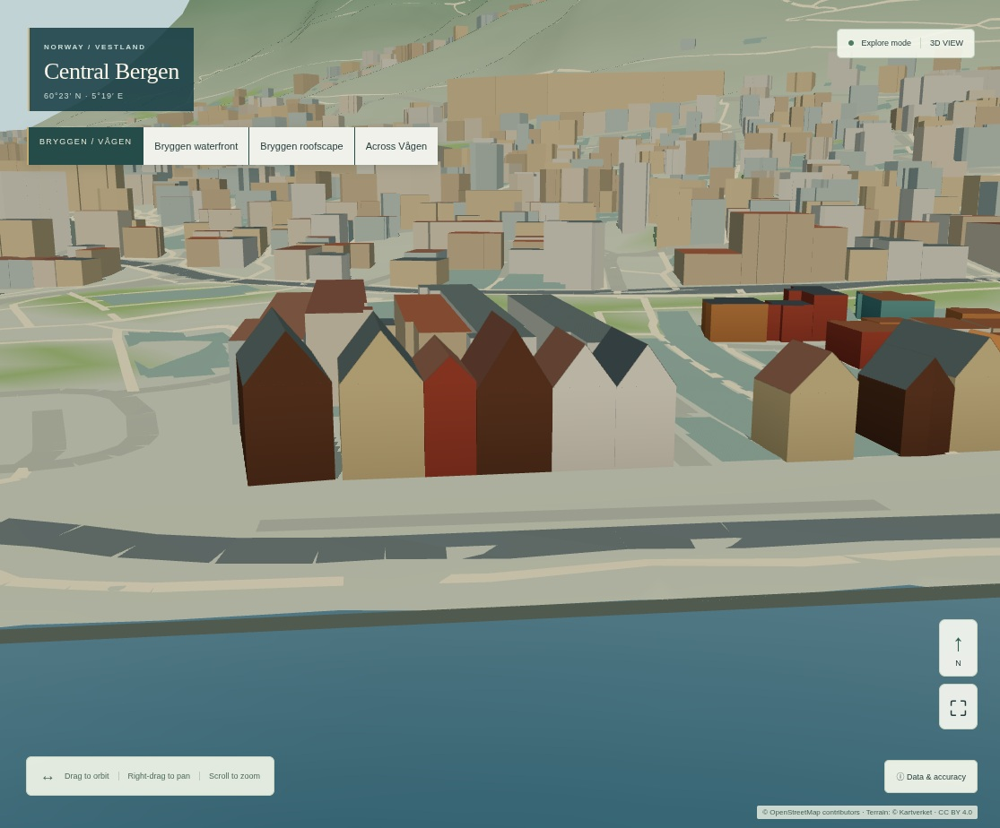
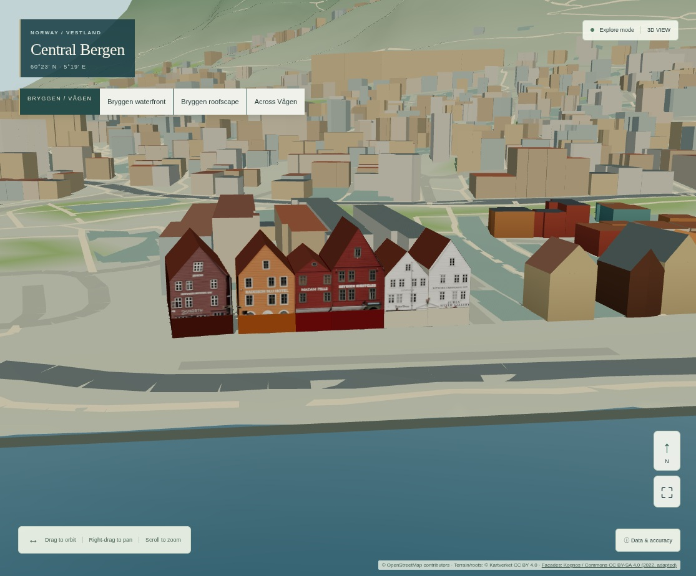
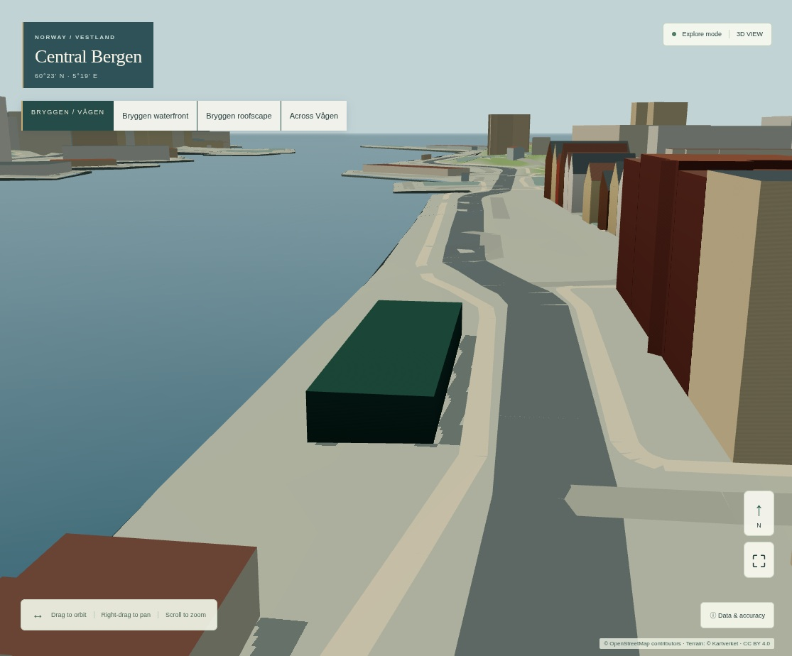
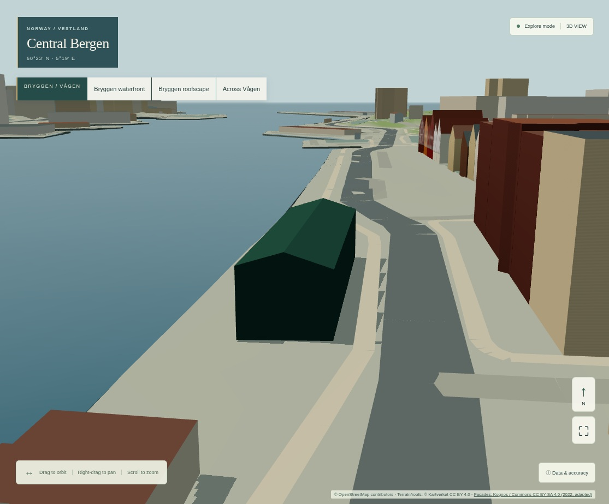

# R1B architectural visual acceptance package

Exact baseline: **b827783c8ebb94e95c4722d1a695d8ab4790e190**. Same source geography,
fixed camera positions, quality, DPR, viewport and production CSP. Captured from local
production builds with software Chromium; no generated reference image or invented
facade feature. Independent native-GPU and Bergen-expert recognition acceptance remain
open. The protected app is https://bergen-reimagined.vercel.app . The final handoff and
[branch Actions history](https://github.com/Lippen1995/Project_statsbudsjett/actions/workflows/bergen-simulator.yml?query=branch%3Afeature%2Fbergen-simulator)
provide the exact released commit/status; these captures precede that release.

| Identical view | R1 | R1B |
|---|---|---|
| Bryggen waterfront | [Before](before/desktop-balanced-waterfront.jpg) | [After](after/desktop-balanced-waterfront.jpg) |
| Roofscape | [Before](before/desktop-balanced-roofs.jpg) | [After](after/desktop-balanced-roofs.jpg) |
| Across Vågen | [Before](before/desktop-balanced-vagen.jpg) | [After](after/desktop-balanced-vagen.jpg) |
| Northern group, closer | [Before](details-before/desktop-northern-group.jpg) | [After](details-after/desktop-northern-group.jpg) |
| Skur 11, axial gable | [Before](details-before/desktop-skur-gable.jpg) | [After](details-after/desktop-skur-gable.jpg) |
| Mobile waterfront | [Before](before/mobile-balanced-waterfront.jpg) | [After](after/mobile-balanced-waterfront.jpg) |
| Mobile facade close-up | [Before](before/mobile-balanced-facades.jpg) | [After](after/mobile-balanced-facades.jpg) |
| Mobile Skur gable | [Before](details-before/mobile-skur-gable.jpg) | [After](details-after/mobile-skur-gable.jpg) |

## Architectural comparison

The coherent six-building sequence now has source-specific dated cladding/window/
signage composition, with four improved laser-derived roof envelopes. The lower
shop bands and non-front faces remain schematic. Two poorly fitted roofs deliberately
retain OSM dimensions; the resulting proportion mismatch remains a limitation.

Skur 11 now has a dated, inferred roof envelope instead of a flat storey estimate.
Its masonry pillars, corrugation and doors are **not** modelled; it does not yet meet
a complete landmark-reconstruction standard.

## Licensed independent references

[Waterfront panorama, 3 October 2022](references/bryggen-2022-kognos.jpg):
Kognos / Wikimedia Commons,
[original and licence](https://commons.wikimedia.org/wiki/File:Panorama_of_Bryggen,_Bergen.jpg),
CC BY-SA 4.0; this reference is resized. The runtime atlas is separately cropped,
resampled and perspective-mapped under the same licence. Signs are historical image
content, not current tenant/ownership facts.

[Skur 11, 4 April 2009](references/skur11-2009-david40226543.jpg):
David40226543 / Wikimedia Commons,
[original](https://commons.wikimedia.org/wiki/File:Skur11.jpg), CC BY-SA 3.0;
resized reference only, not a runtime texture. No endorsement implied. After-render screenshots containing the adapted atlas are shared under CC BY-SA 4.0 with the Kognos / Commons and geographic credits retained.

Use [the full source register](../r1b-asset-source-register.md) and
[implementation/truth boundaries](../r1b-architectural-realism.md) when reviewing.
Project/service metadata: [DOM project](sources/dom-project.json),
[DOM service](sources/dom-service.json). Exact source hashes and crop/fit parameters
are in the app's input lock/compiler/catalogue; no original snapshot is overwritten.

## Verification

[Performance and limitations](performance.md), [R1 raw](before/metrics.json),
[R1B raw](after/metrics.json), [asset lifecycle and picking](assets/report.json),
[validation receipt](validation.json), [artifact integrity](manifest.json).
Low-power and all fixed-view screenshots are retained in the corresponding folders.
The rejected startup/visual probes are labelled diagnostics, not accepted evidence.

The visual review supports identifiable individual photographed fronts and improved
roof proportions, **not** photorealistic, current, surveyed architecture. Missing
facade depth, roof breaks/dormers, unknown side faces, lower shops, Skur pillars and
possible distant envelope-LOD popping remain. Envelope swaps are discrete under
hysteresis; photo appearance fades. A larger asset library and public LIVE launch
are not approved by this benchmark.
