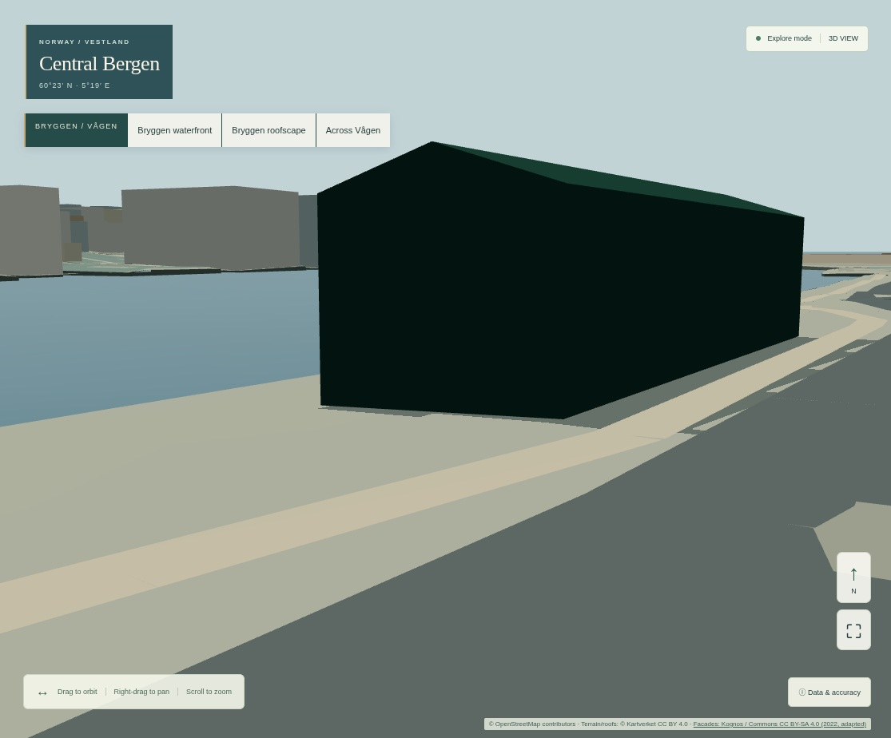
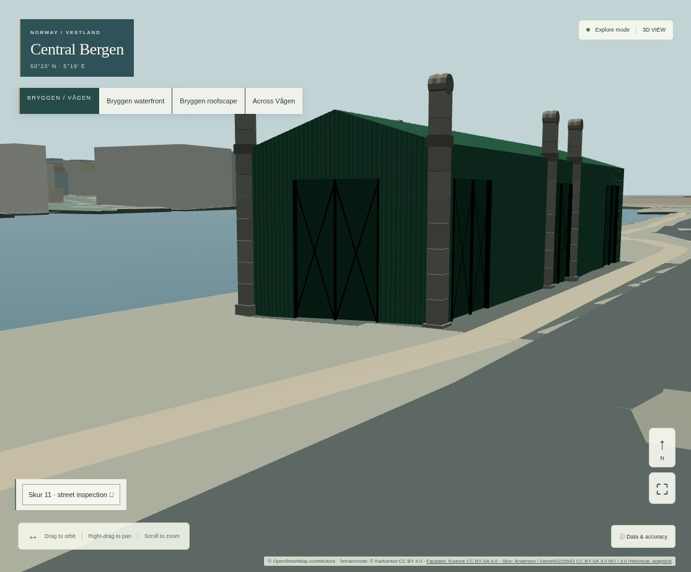

# R1C visual acceptance evidence

Exact R1B baseline: **d278ec9a5f17f5750c4a62a0bfae6c0ee891e0f8**.
Same source geography, software Chromium, viewport/DPR/quality/CSP and fixed cameras.
These are screenshots of local production builds, not generated reference images.
The protected release URL remains https://bergen-reimagined.vercel.app .

| View | R1B | R1C |
|---|---|---|
| Aerial | [Before](views-before/desktop-aerial.jpg) | [After](views-after/desktop-aerial.jpg) |
| Bryggen waterfront | [Before](views-before/desktop-waterfront.jpg) | [After](views-after/desktop-waterfront.jpg) |
| Street frontal | [Before](views-before/desktop-street-frontal.jpg) | [After](views-after/desktop-street-frontal.jpg) |
| Street angled | [Before](views-before/desktop-street-angled.jpg) | [After](views-after/desktop-street-angled.jpg) |
| Roof | [Before](views-before/desktop-roof.jpg) | [After](views-after/desktop-roof.jpg) |
| Architectural detail | [Before](views-before/desktop-detail.jpg) | [After](views-after/desktop-detail.jpg) |
| Road side | [Before](views-before/desktop-roadside.jpg) | [After](views-after/desktop-roadside.jpg) |
| Mobile frontal | [Before](views-before/mobile-street-frontal.jpg) | [After](views-after/mobile-street-frontal.jpg) |
| Mobile angled | [Before](views-before/mobile-street-angled.jpg) | [After](views-after/mobile-street-angled.jpg) |

The new relief is geometry rather than a flat Skur photo: recessed ports, projecting
piers, metal bracing, capital profiles and corrugation. Material colours and relief
depths remain illustrative; historical relative feature registrations are inferred.
The [five-criterion assessment](../r1c-landmark-fidelity.md) records each shortcoming.
Independent Bergen-expert recognition and native hardware performance remain open.

## Interactive inspection

[Desktop gable](inspection/desktop-gable.jpg), [quay](inspection/desktop-quay.jpg),
[road](inspection/desktop-street.jpg), [capital close-up](inspection/desktop-stone.jpg);
[mobile gable](inspection/mobile-gable.jpg), [mobile capital](inspection/mobile-stone.jpg).
The browser receipt verifies finite flight, skip, direct source picking, keyboard
zoom/clearance, touch orbit, return to city and zero settled idle frames.

## Licensed historical references

- [2009 gable/quay](references/skur11-2009.jpg), David40226543 / Commons,
  [original](https://commons.wikimedia.org/wiki/File:Skur11.jpg), CC BY-SA 3.0.
- [2012 capital/port](references/Skur_11a.jpg), [cladding](references/Skur_11b.jpg),
  [oblique street side](references/Skur_11c.jpg), [street front](references/Skur_11d.jpg),
  Jonatan Andersen / Commons, 21 April 2012,
  [original collection](https://commons.wikimedia.org/wiki/Category:Skur_11),
  [CC BY-SA 3.0 Norway](https://creativecommons.org/licenses/by-sa/3.0/no/).

These copies are resized, not used as Skur runtime textures. Photographs are not
metric surveys or proof of current condition. Original byte hashes and transformations
are in [the source register](../r1c-source-register.md) and input lock. Photo-derived
Skur contributions retain their attributed share-alike terms. Screenshots also include
existing OSM (ODbL), Kartverket (CC BY 4.0) and, where visible, Kognos' 2022 CC BY-SA 4.0
atlas; those layer credits remain. Composite screenshots are shared under CC BY-SA 4.0
with the original attributed component licences preserved; no endorsement implied.

## Measurements and verification

[Budgets](preimplementation-budget.md), [performance comparison](performance.md),
[R1B raw](before/metrics.json), [R1C raw](after/metrics.json),
[inspection receipt](inspection/report.json), [asset lifecycle](assets/report.json),
[close baseline](close-before/metrics.json), [close result](close-after/metrics.json),
[validation](validation.json), [artifact hashes](manifest.json).

The exact baseline archive helper compares dependency locks and copies only the test
harness/cameras. Source files are never refreshed or swapped in the active branch.
Real hardware procedure: [R1C desktop/mobile acceptance](physical-device-procedure.md).
No public diagnostic endpoint or authentication bypass is introduced.
