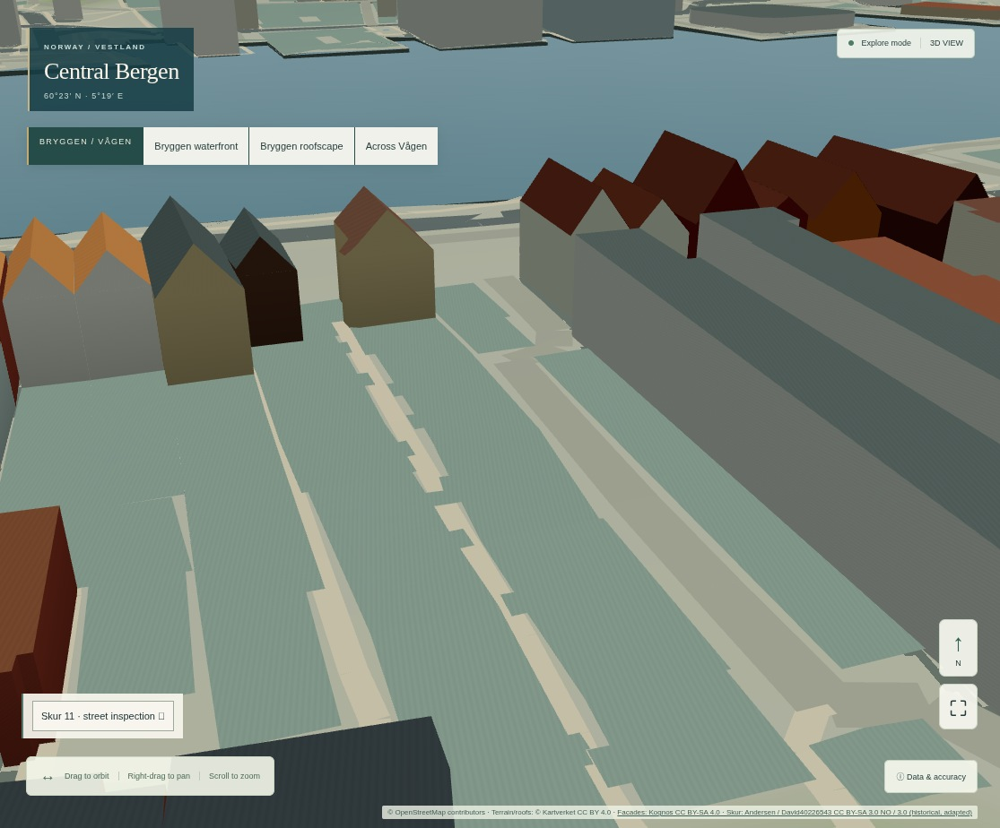
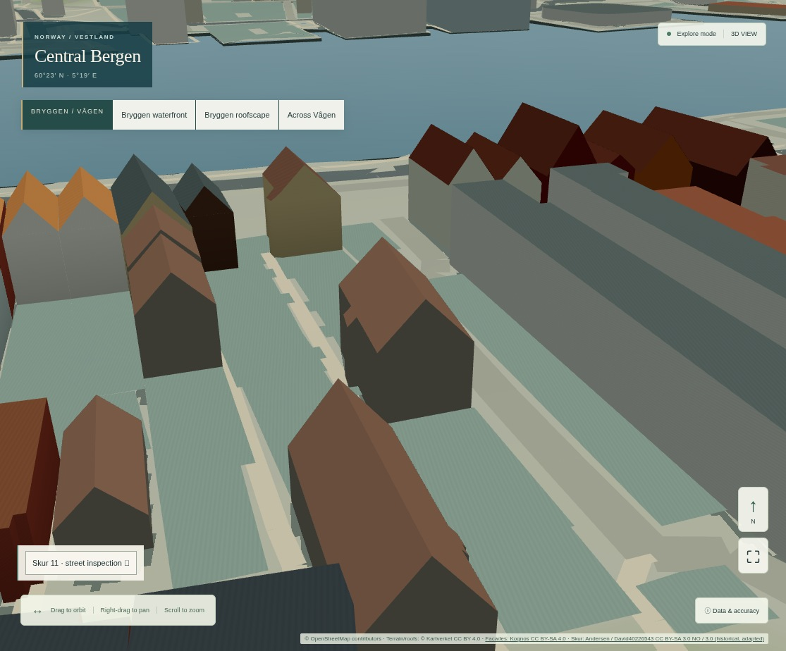

# R1E — visuell evidens, dataprøver og validering

21. oktober 2026. **Geometrisk kildeforbedring, ikke ferdig arkitektonisk digital tvilling.** Seks eksisterende, tidligere høydeukjente bygninger får et separat 2022-basert render-volum. Ingen nye faktiske bygninger eller målte fasader er importert.

## Sammenlignbare bilder

`before/` er tatt fra uendret historisk gren-HEAD `c87db8bfe73e4e73a49bc0160a91116615274893`, bygget fra et separat `git archive` uten grenbytte. Endelig før/etter-kjøring bruker samme korrigerte kameradriver. `after/` viser både originalvisning (`off`) og ny pilot (`on`). Alle fire opprinnelige kamerastillinger og begge viewport-størrelser er **pikselidentiske før/etter når laget er av**, kontrollert etter JPEG-dekoding. Slik dokumenteres at originalbyen kan vises uendret. Den nye lave kamerastillingen har et separat av/på-par fra samme bygg, ikke et oppfunnet gammelt baselinebilde.

| Motiv | Original | Nytt taklag |
| --- | --- | --- |
| Vågen / Bryggen | [før](before/desktop-off-waterfront.jpg) | [etter](after/desktop-on-waterfront.jpg) |
| Pilot ovenfra | [før](before/desktop-off-aerial-pilot.jpg) | [etter](after/desktop-on-aerial-pilot.jpg) |
| Representative tak / ukjente høyder | [før](before/desktop-off-representative-roofs.jpg) | [etter](after/desktop-on-representative-roofs.jpg) |
| Lav Bryggen-visning (kamera 12 m NN2000, ikke øyehøyde) | [før](before/desktop-off-bryggen-street.jpg) | [etter](after/desktop-on-bryggen-street.jpg) |
| Gatehøyde ved `way/331274548` (4,5 m NN2000) | [original av](after/desktop-off-bryggen-lane-eye-level.jpg) | [pilot på](after/desktop-on-bryggen-lane-eye-level.jpg) |
| Mobil takvisning, 390 × 844 | [før](before/mobile-off-representative-roofs.jpg) | [etter](after/mobile-on-representative-roofs.jpg) |
| Mobil gatehøyde | [original av](after/mobile-off-bryggen-lane-eye-level.jpg) | [pilot på](after/mobile-on-bryggen-lane-eye-level.jpg) |

**Originale ukjente høyder:**

**Valgfritt, kildeavledet volum:**

### Visuell vurdering og begrensninger

- Den tydeligste forskjellen er at hull mellom sjøhusenes bakre volum får reelle, kildeidentifiserte takkonvolutter. 2022-overflate og originalt fotavtrykk gir støtte; fullstendig arkitektur og nåtidsutseende er ikke verifisert.
- Vannkantbildet endrer seg mindre fordi de syv eksisterende sjøfasade-/landemerkebyggene har forrang og skjuler deler av pilotområdet. Det er forventet, ikke grunn til å erstatte dem.
- Gatehøydebildet viser et faktisk nytt tredimensjonalt volum, men også begrensningen: glatte, mørke, skjematiske fasader og grove nabotak. Det oppfyller **ikke** en fotorealistisk gatefasadebenchmark. Ingen ukjente vinduer eller dører er lagt til for å pynte på resultatet.
- Den første ekstra gatekameraprøven ble korrigert etter visuell gjennomgang fordi veggen fylte bildet. Den aksepterte posisjonen er utenfor kildefotavtrykk, har fri siktlinje til målbygget og er innen eksisterende kameragrenser. Byen er ikke flyttet eller skjult for å oppnå utsnittet. Det er ingen ny gåmodus.
- Skjematisk grunnkontakt følger eksisterende terreng, og eldre grove nabotak/terreng kan fortsatt se feil ut fra gaten. R1E retter ikke disse uten en separat kildeversjon.
- Bilder fra ulike kameraer er ikke innbyrdes før/etter-bevis. Posisjoner, mål, FOV, DPR og viewport ligger i rapportene.

## Kildebevis

- [Originale 25 cm DOM/DTM og prosjektmetadata](../../../apps/bergen-simulator/tests/fixtures/r1e/); [låste URL-er og SHA-256](../../../apps/bergen-simulator/scripts/r1e-inputs.json).
- [72 bygningsvurderinger og seks integrerte ID-er](roof-results.json): opprinnelig høyde/status, overflatekvantiler, taktest og avvisningsgrunn. Q90 over terreng er ikke identisk med total OSM-høyde; differansen alene er ingen nøyaktighetsmåling.
- [2026-epoch-kontroll](epoch-comparison.json), med [original DOM](source-samples/comparison-2026-dom-025.tif) og [avvist null-DTM](source-samples/comparison-2026-dtm-025.tif). Ingen 2026-resultater er promotert. Fire av seks nyere overflater passer ikke den enkle takmodellen; dette kan ikke alene tolkes som faktisk ombygging.
- [93 NVDB-seksjoner](source-samples/nvdb-v4-utm33.json), [tom neste side](source-samples/nvdb-v4-page2.json) og [geometrikontroll](nvdb-validation.json). NLOD: Inneholder data under norsk lisens for offentlige data (NLOD) tilgjengeliggjort av Statens vegvesen. Ikke integrert i rutemotoren.
- [Norge i bilder: 37 prosjektmetadata](metadata/niib-projects.json), 1948–2026, oppgitt pixelSize 0,05–10 m på tvers av produktene. Prosjektår og oppløsning er ikke en selvstendig kvalitetstest. Ingen ortofotopiksler er hentet.
- [Matrikkelen-prøve](registry-pilot.json): seks eksplisitte, mindre byggforespørsler og HTTP 504, ikke seks bygninger som mangler i registeret. Alternativ leverings-capability, formater og områder ligger i `metadata/`.
- [Historisk Bredsgården-foto](source-samples/uib-bredsgarden-1918-1922.jpg): **Atelier KK / Universitetsbiblioteket i Bergen**, `ubb-kk-n-165-017`, 1918–1922. [Originalside og konkrete vilkår](https://marcus.uib.no/instance/photograph/ubb-kk-n-165-017.html). Uendret medium-JPEG, kildehenvisning beholdes; ikke nåtidsfasade, tekstur eller oppmåling.
- [Originale offentlige metadata](metadata/), [prøvenes hasher](sample-checksums.json), [80 registrerte tilgangsforsøk](access-attempts.json). Metadata om et begrenset produkt innebærer ikke at produktets geometri er kopiert eller kan hostes.

## Målt rendering

Kjøring: Node 24.19.0, Chromium 151, ANGLE SwiftShader, Balanced, DPR 1, samme lokale produksjonsbygg/CSP. Desktop 1440 × 1000; mobil 390 × 844 med berøringsemulering. **Ingen fysisk GPU eller fysisk mobil er testet.**

| Måling | Baseline | R1E på |
| --- | ---: | ---: |
| Draw calls i fast vannkantbilde | 7 | 8 |
| Synlige trekanter i samme bilde | 288 848 | 288 976 |
| Sceneattributt-/indeksarrayer, byte | 29 146 950 | 29 164 038 |
| Teksturer | 2 | 2 |
| Desktop kameradriver, median / P95 | 296,5 / 355,8 ms | 300,7 / 345,7 ms |
| Mobil viewport kameradriver, median / P95 | 184,8 / 194,2 ms | 169,7 / 200,0 ms |
| Klar scene, desktop | 3 709 ms | 3 821 ms |
| Klar scene, mobil viewport | 2 294 ms | 2 404 ms |
| Nye idle-frames etter settling | 0 | 0 |

[Maskinrapport og budsjettutfall](benchmark-summary.json), [før råmålinger](before/report.json), [etter råmålinger](after/report.json), [forhåndsbudsjett](preintegration-budget.md). 56 målte kameraprøver per variant etter åtte oppvarmingsprøver. Protokoll v2 venter eksplisitt på et nytt tegnet bilde ved beordret kamera før to RAF-er og `gl.finish()`. Median/P95 er driverforsinkelse, **ikke fysisk FPS eller rene GPU-frame-tider**. Klar scene er venting på geometri/eksisterende teksturer; den valgfrie takflisen lastes først ved aktivering. Lastetidsforskjellen kan skyldes cache/JIT og enkeltkjøringsstøy; ingen påstått ytelsesoptimalisering.

En tidligere målemetode ventet ikke eksplisitt på det nye kamerabildet og ga en urealistisk prøve på 2,7 ms etterfulgt av 311 ms. Den rå [diagnosekjøringen](after-fresh-first-report.json) og de opprinnelige [før](legacy-driver-before-report.json)/[etter](legacy-driver-after-report.json)-rapportene beholdes for sporbarhet, men brukes ikke i tabellen. Begge historiske og nye bygg er målt på nytt, sekvensielt og uten samtidige nettlesersuiter, med protokoll v2. Rårapporten inkluderer også ny kode med laget av: desktop P95 er 391,0 ms, mot 355,8 ms historisk; begge tilstander er innen forhåndsbudsjettet. Forskjellen illustrerer programvarerendererens variasjon, ikke en påvist optimalisering.

Ekstra fil er **15 160 byte**, 162 trekanter før de gamle fotavtrykkflatene filtreres bort, netto 128 i målt bilde, én draw call, ingen tekstur. CPU-målte sceneattributter øker 17 088 byte. Dette er **ikke målt fysisk VRAM** eller en full JS-heapmåling. Fem av/på-sykluser gir stabile siste geometri-/attributtall; lav effekt, tilbake til Balanced, 404 og avbrutt/stale innlasting beholder eller gjenoppretter originalene. Ingen påstand om langtidslekkasjefrihet eller iPhone-ytelse.

### Reproduserbar fysisk maskinvaretest

Start samme statiske bygg lokalt og åpne `http://localhost:4180/?capture=1` på fysisk desktop. DevTools Performance med identiske faste kameraer, viewport og DPR; noter GPU, OS, browser, termisk tilstand, lys/shadow-kvalitet, nett/cache og minst tre kalde/varme repetisjoner. Mål hovedtråd, render-/presentasjonslatens, GPU-tid der støttet, heap etter GC og fem lag-/scenario-bytter. På fysisk Android brukes DevTools USB-port-forward til telefonens localhost og remote inspection; på iOS Safari Web Inspector og dokumentert lokal tilkobling. Ikke påstå at localhost-instrumenteringen automatisk finnes på LAN-/produksjonsdomene.

Gjenta med og uten taklaget og inkluder vanlig orbit/zoom/berøring, valgt objekt og tilbake til byoversikt. Instrumenteringen er fortsatt bare aktiv på localhost/127.0.0.1 og samler ingen brukerdata. **Ikke** åpne privilegerte diagnoseendepunkter eller svekk Vercel Authentication for maskinvaretest.

## Utførte tester

Første CI-forsøk, [39562912976](https://github.com/Lippen1995/Project_statsbudsjett/actions/runs/39562912976), stoppet i TypeScript før deploy: den nye testen aksesserte et valgfritt `ground`-felt uten eksplisitt kontroll. Testen er rettet med en faktisk tilstedeværelsesvakt. Lokale porter og nettlesere kjøres deretter på nytt mot et ferskt, vellykket TypeScript-bygg; endelige logger i denne mappen gjelder denne omkjøringen. Den første kjøringen gjorde ingen deploy.

- `npm run lint`: bestått, ingen advarsler.
- `npm test`: **244 Vitest-tester i 16 filer + 10 release-/CI-policytester**, bestått.
- TypeScript og `npm run build`: bestått. Eksisterende Vite-varsel om Scene-chunk over 500 kB består; det er ikke en ny feil.
- `npm run check:isolation`: bestått. I tillegg sammenlignes alle opprinnelig sporede filer med hashene fra oppgavens start før commit.
- Nye GIS-tester: **5**, bestått. Kildeintegritet, native CRS/rutenett/datum, deterministisk GLB, fotavtrykkdekning, gamle modellers forrang, utenfor/ugyldig/hull/NoData/null-DTM og kildedrift.
- Tidligere GIS-/rekonstruksjonstester: importer 3, architectural importer 3, R1C reconstruction importer 6, connectivity audit 3, research adapters 2 og missing-buildings audit 18: **35**, bestått.
- Ny R1E nettlesertest: desktop og touch/mobil, eksakte kameraer, kildesporbar plukking, fem sykluser uten økende beholdte attributter, null idle, lav effekt/resume, manglende fil og avbrutt lasting: bestått.
- Alle **12 eksisterende nettlesersuiter**: grunnapp, visuell, gateplan, offentlig rom, bygg, Living City, City Management, connected-city, access, R1 quality, R1B details og R1C inspection: bestått. [Liste](browser-regressions.txt), [GIS-liste](gis-regressions.txt) og relevante rålogger følger evidensen.
- PDAL/roofer på original LAZ: **ikke kjørt**, fordi ingen rå klassifisert kildefil ble levert. Ingen rasterprøve utgis for å være dette forsøket.
- Ny uavhengig tak-/fasadesurvey og fysisk GPU-test: **ikke tilgjengelig**.

Python GIS: numpy 2.5.4, rasterio 1.4.4, pyproj 3.7.2, shapely 2.1.2, låst i [r1e-requirements.txt](../../../apps/bergen-simulator/scripts/r1e-requirements.txt); se [prosesseringskode](../../../apps/bergen-simulator/scripts/r1e_geodata.py), [reproduksjon av epoch-kontroll](../../../apps/bergen-simulator/scripts/r1e_compare.py) og [offline-tester](../../../apps/bergen-simulator/tests/public_geodata.py). Rasterio med numpy 2.5.4 gir en kjent deprecation-advarsel ved array-lesing; testene og bit-reproduksjonen består. Ingen ny runtime-avhengighet er introdusert.

Utgivelsesstatus og beskyttelseskontroll oppgis i leveringsrapporten etter den godkjente [Bergen-workflowen](https://github.com/Lippen1995/Project_statsbudsjett/actions/workflows/bergen-simulator.yml). Denne evidensen beskriver de faktiske lokale portene før commit; ingen endring av workflows eller beskyttelsesinnstillinger inngår.
