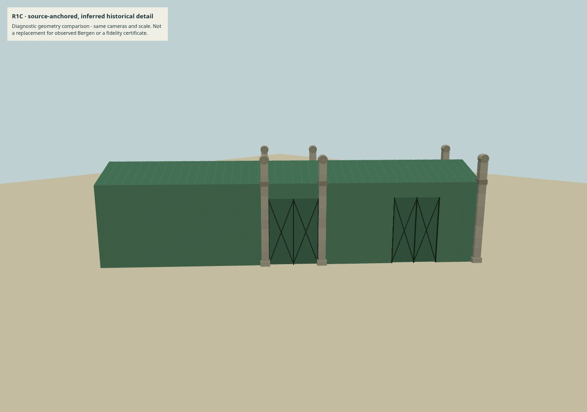
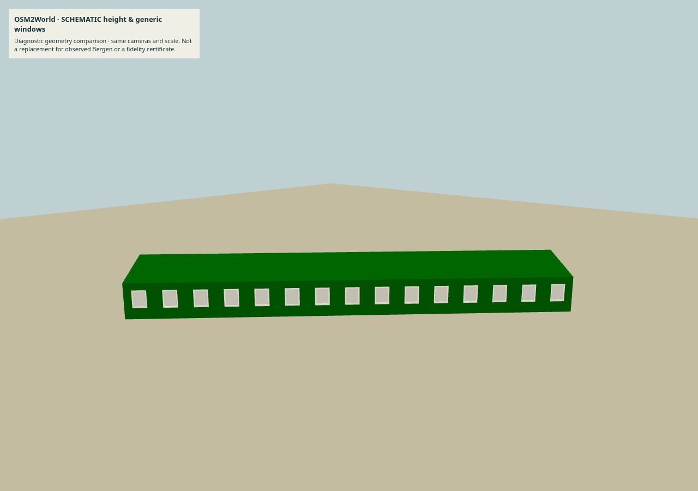

# Prototype: Skur 11, automatisering og GLB-levering

Utført 19. oktober 2026 mot R1C `358b3e03649de9550af66697a76d86471e53ccee`.
Bare isolerte forskningsfiler; ingen modell erstatter observerte kildeposter eller
runtime-asset. [Rettigheter](NOTICE.md), [primærkilder](source-register.md),
[reproduksjon](reproduction.md) og [neste fase](next-phase.md).

## Visuell sammenligning

Samme skala, kameravinkler, enkle diagnostiske materialer og lys i hver kolonne.
Modellene er kun translatert til visningssentrum/bakken, ikke deformert eller
størrelsestilpasset. Dette er ikke en geografisk registrering eller ny materialaksept.

| Visning | Dagens R1C | OSM2World, generisk | R1C komprimert |
|---|---|---|---|
| Desktop, skrått | [R1C](evidence/desktop-r1c-angled.jpg) | [OSM](evidence/desktop-osm-angled.jpg) | [Meshopt](evidence/desktop-meshopt-angled.jpg) |
| Desktop, andre siden | [R1C](evidence/desktop-r1c-front.jpg) | [OSM](evidence/desktop-osm-front.jpg) | [Meshopt](evidence/desktop-meshopt-front.jpg) |
| Emulert mobil, skrått | [R1C](evidence/mobile-r1c-angled.jpg) | [OSM](evidence/mobile-osm-angled.jpg) | [Meshopt](evidence/mobile-meshopt-angled.jpg) |

OSM2World lager en rad standardvinduer og et 3,5 m høyt volum selv om snapshoten
ikke dokumenterer slike vinduer eller metriske høyder. Pilarer, kapiteler og de
fotostøttede portene mangler. Output på LOD4 blir derfor **avvist som landemerke**.
Dette sier ikke at verktøyet alltid gjør feil, men viser hva manglende bygningsmetadata
betyr her. En annen stilkonfigurasjon kan fjerne standardvinduer, ikke bevise nye detaljer.
R1C forblir en delvis historisk rekonstruksjon med usikre detaljmål og skjulte sider.
Ingen ekstern Bergen-kjenner har gitt ny gjenkjennelighetsaksept i denne undersøkelsen.

## Geometri, fil og logiske buffere

Skur er tatt ut separat, med **eksakte originale attributtbytes**. Hele R1C-flisen
på 675 280 byte har også seks nabobygg og et atlas og er ikke direkte sammenlignbar.
Alle fire forsøksmodellene har null teksturer. Eksperimentets material-/sceneoppsett
har to renderkall: én bygningsmesh og én diagnostisk bakke.

| Modell | GLB byte | Trekanter | Logiske attributt- og indeksbyte | Kilde-ID |
|---|---:|---:|---:|---|
| r1c | 402,684 | 3,716 | 401,328 | way/393025479 |
| indexed | 323,456 | 3,716 | 322,248 | way/393025479 |
| meshopt | 54,080 | 3,716 | 188,936 | way/393025479 |
| osm | 127,448 | 1,162 | 125,496 | w393025479 |

Indeksering gir eksakt samme utvidede posisjonsrekkefølge og 0 avvik. Meshopt med
16-bit posisjoner/12-bit normaler/16-bit farge gir største symmetriske nærmeste-
vertex-avvik **0,0003474 m** mot R1C, under forsøksgrensen 0,002 m. Dette er et
vertex-settmål, ikke komplett overflatefeil og **ikke** Bergens virkelige nøyaktighet.
Antall trekanter og kilde-ID er bevart. [Rå sammenligning](evidence/geometry-comparison.json).

GLB blir ca. 86,6 % mindre og de logiske buffere ca. 52,9 % mindre enn enkeltbyggets
original. Det sier ikke hva peak decode-heap eller faktisk VRAM blir, og sparer
ikke automatisk teksturminne i byens separate fotoatlas.

Dagens strenge applikasjonsloader avviser indekser og required extensions. Den er
**ikke** endret. Prototypen demonstrerer kompatibilitet med Three.js' ordinære
GLTFLoader + eksisterende MeshoptDecoder, ikke en ferdig produksjonsintegrasjon.

## Fotogrammetri – faktisk negativt resultat

Fem allerede lisensierte originaler ble hash-kontrollert og kopiert til midlertidig
COLMAP-arbeidsmappe: 2009-bildet og de fire Jonatan Andersen-fotoene fra 2012.
Ingen bildefylling, ukjent arkitektur, kunstig kamerabane eller ny tekstur ble laget.

| Oppsett | Features / matching / mapping, sekunder | Prosess-topp-RSS | Initialiserte modeller |
|---|---|---|---:|
| 1600 px, SIFT/veiledet matching | 20.88 / 3.06 / 0.12 | 1.16 GiB | 0 |
| 2400 px, affin DSP-SIFT/veiledet matching | 55.70 / 5.95 / 0.09 | 2.19 GiB | 0 |

Begge har ingen initialisert modell. Standardoppsettet finner bl.a. 221 og 240
geometrisk verifiserte korrespondanser i to bildepar; det er ikke et metrisk bygg.
Det finnes ingen akseptert målestokk/georeferanse eller komplett fasademesh, så
GLB-størrelse, fasadefeil og render-ytelse for en COLMAP-rekonstruksjon er **ikke tilgjengelig**.
Tett MVS ble ikke kjørt på et ugyldig/ikke-eksisterende sparse-grunnlag.

Bildene er historiske, har ulike utsnitt og mangler en planlagt kameraserie og
uavhengig kalibrering/kontroll. Forsøkene diagnostiserer disse konkrete oppsettene;
vi har ikke bevist en eneste årsak til feilen eller utelukket andre matchere,
kalibreringer og fotoserier. Ingen inlier-/vinkelkrav ble senket for å tvinge fram et resultat.
Se [standard](evidence/sfm-standard.json) / [utvidet](evidence/sfm-enhanced.json).
Meshroom/OpenMVS/roofer/BlenderGIS er ikke rapportert som kjørte rekonstruksjoner.

## Isolert desktop-/mobilmåling

Chromium 151 / ANGLE SwiftShader, DPR1; desktop 1280×900 og emulert touch 390×844.
Fire warmups og tolv beholdte kameraendringer, to RAF + gl.finish. Programvaredriver-
fullføring er **ikke fysisk FPS eller touch-to-photon**. Null kontinuerlig renderloop.
Ingen ekstern runtime-request eller browserfeil i åtte caser; kildeplukking bestått.

| Viewport | Asset | Første interaktiv visning ms | GLB parse ms | Kamera median ms | P95 ms | Idle frames |
|---|---|---:|---:|---:|---:|---:|
| Desktop | r1c | 1623.8 | 7.0 | 119.4 | 152.1 | 0 |
| Desktop | indexed | 371.0 | 7.2 | 145.5 | 176.6 | 0 |
| Desktop | meshopt | 674.0 | 8.6 | 148.8 | 315.6 | 0 |
| Desktop | osm | 305.5 | 10.4 | 88.8 | 301.6 | 0 |
| Emulert mobil | r1c | 292.2 | 6.9 | 76.8 | 107.4 | 0 |
| Emulert mobil | indexed | 292.6 | 31.2 | 76.0 | 89.9 | 0 |
| Emulert mobil | meshopt | 283.2 | 10.8 | 84.9 | 114.5 | 0 |
| Emulert mobil | osm | 231.1 | 10.5 | 34.7 | 57.8 | 0 |

Fast rekkefølge/JIT/shaderoppvarming gir særlig første desktop-case en kald start.
Én oppstart per case er ikke en cold-load-fordeling, og lokal loopback er ikke
mobilnett. Dette er ikke bevis for at Meshopt/indeksering gjør kameraet raskere:
indeksert/komprimert desktop er faktisk tregere i denne kjøringen, og P95 er støyende.
Ikke velg teknikk på disse tidene alene. Den sikre påviste gevinsten er mindre fil
og logiske buffere med kontrollert geometriavvik. To renderkall består, og idle er 0.

Målingen har ingen hel by, skygger/atlas, applikasjonsworker eller spillscenario.
Den erstatter ikke [R1C sin fullscene-baseline](../r1c-evidence/performance.md).
Native GPU/VRAM, mobile Safari, fysisk touch, termikk, minne etter lange spilløkter
og LOD-streaming er **ikke testet**. Viewerens ekstra vertex-diagnostikk bruker også
heap; vi påstår ikke et produksjonsmål for JS-peak-minne her.
[Rå browsermålinger](evidence/browser.json).

## Kontrollstatus og videre bruk

Adaptertester verifiserer uendrede kildekoordinater/tags, tydelig skille fra originale
node-ID-er, byte-identisk uttrekk og reproduksjon. CLI/verktøylåser og rårapporter
følger artefaktene. [Valideringskvittering](validation.json), [hash-manifest](manifest.json).

Ingen mer detaljert Bergen-geometri er godkjent eller publisert av forsøket.
Neste riktige investering er rettighetsklarert kilde-/opptaksgrunnlag og en kontrollert
hybridpilot, etterfulgt av trygg loader-utvidelse og fysisk enhetstest.
